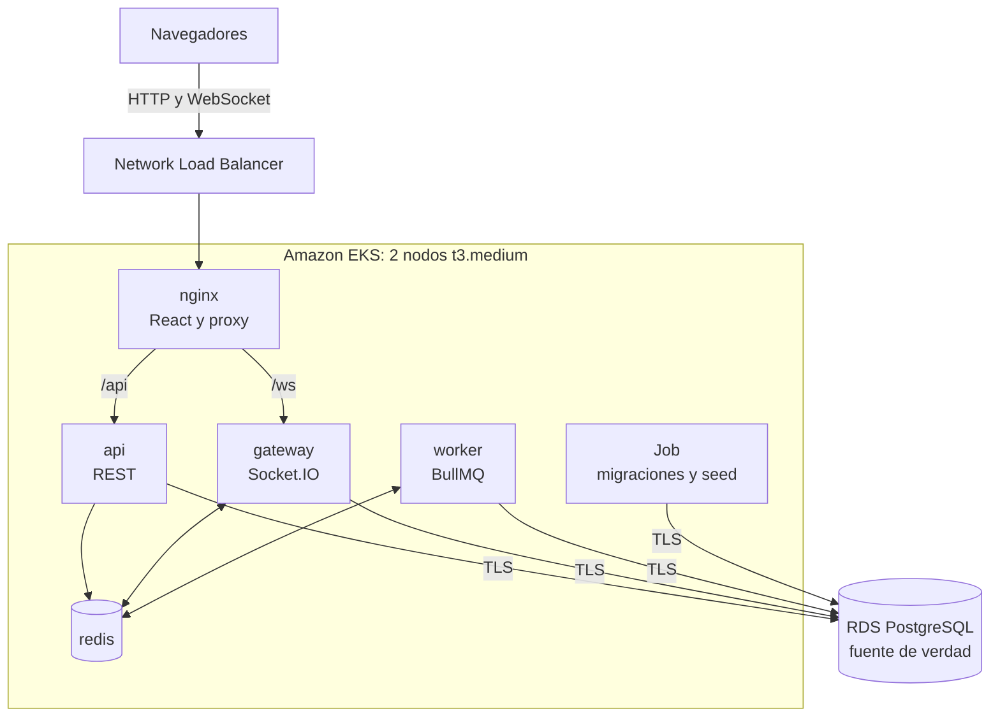
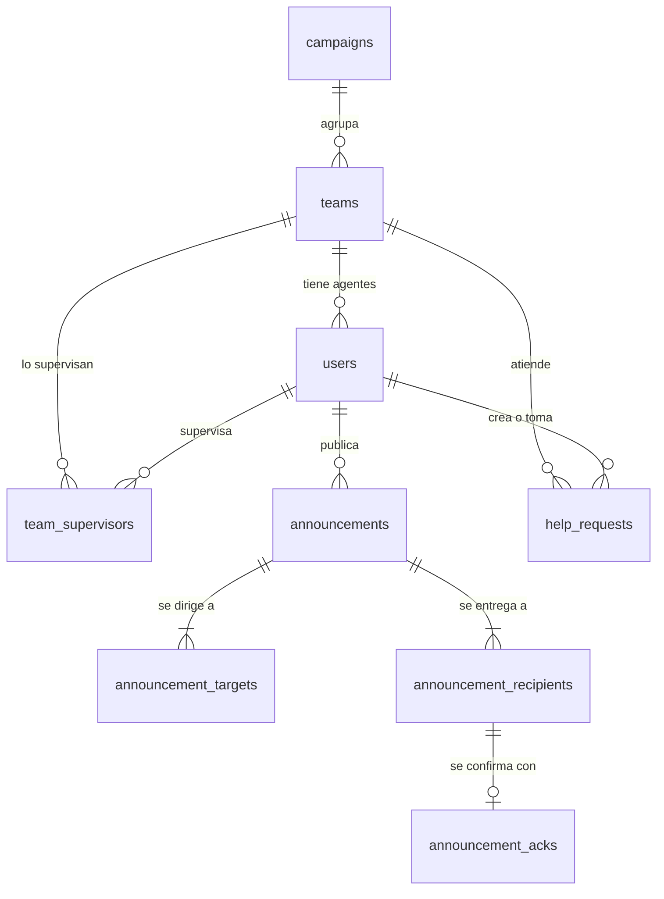

# FloorHub

Plataforma interna para el piso de operaciones de un BPO. Resuelve dos problemas reales:

1. **Los procesos cambian a diario y los agentes se enteran tarde.** Los comunicados llegan al instante y el supervisor ve en vivo quién confirmó y quién no.
2. **Las solicitudes de ayuda se pierden en chats generales.** Una cola ordenada garantiza que cada solicitud tenga un único responsable.

Proyecto final de universidad, diseñado para mantenerse por debajo de **30 USD** en AWS.

## Arranque rápido

Necesitas Docker y Make.

```bash
make up
```

Abre <http://localhost:8080>. La contraseña de todos los usuarios locales es `Demo-FloorHub-2026`.

| Rol | Nombre | Correo | Equipo |
|---|---|---|---|
| Administrador | Andrés Felipe Morales | `andres.morales@floorhub.com` | — |
| Supervisor | Laura Valentina Gómez | `laura.gomez@floorhub.com` | Retención |
| Supervisor | Julián Andrés Herrera | `julian.herrera@floorhub.com` | Soporte técnico |
| Supervisor | Paola Andrea Castaño | `paola.castano@floorhub.com` | Tarjetas |
| Agente | Santiago Ramírez | `santiago.ramirez@floorhub.com` | Retención |
| Agente | Daniela Ospina | `daniela.ospina@floorhub.com` | Retención |
| Agente | Camilo Rincón | `camilo.rincon@floorhub.com` | Retención |
| Agente | Valentina Muñoz | `valentina.munoz@floorhub.com` | Soporte técnico |
| Agente | Sebastián Cárdenas | `sebastian.cardenas@floorhub.com` | Soporte técnico |
| Agente | Mariana López | `mariana.lopez@floorhub.com` | Soporte técnico |
| Agente | Felipe Arango | `felipe.arango@floorhub.com` | Tarjetas |
| Agente | Natalia Quintero | `natalia.quintero@floorhub.com` | Tarjetas |
| Agente | Juan David Mejía | `juan.mejia@floorhub.com` | Tarjetas |

Retención y Soporte técnico pertenecen a la campaña *Telecomunicaciones Andina*; Tarjetas, a *Banco del Valle*. Cada ventana conserva su propia sesión, así que puedes abrir varias con usuarios distintos en el mismo navegador.

> Si ya tenías datos de una versión anterior (usuarios `@floorhub.test`), ejecuta `make reset && make up` para empezar con los usuarios nuevos.

### Demostración de 3 minutos

1. Abre tres ventanas: Laura Gómez (supervisora), Santiago Ramírez y Daniela Ospina (agentes). Laura los ve conectados en **Presencia**.
2. Como Laura, entra a **Nuevo comunicado** y publica uno **crítico** para el equipo *Retención*, con recordatorio cada 1 minuto. Llega al instante a los agentes.
3. En **Comunicados publicados**, abre ese comunicado. Confirma como Santiago y mira cómo sube el porcentaje.
4. Espera un minuto: Daniela recibe un recordatorio y Santiago no.
5. Como Daniela, entra a **Levantar la mano** y pide ayuda. La solicitud aparece en la **Cola de ayuda** de Laura.
6. Como Laura, tómala y resuélvela. Daniela lo ve en vivo, con sus tiempos de espera y atención.

### Páginas por rol

Cada función tiene su propia página en el menú lateral, y los selectores de campañas, equipos, supervisores y destinatarios tienen buscador.

| Rol | Páginas |
|---|---|
| Administrador | Listado de usuarios · Agregar usuario · Editar usuario · Listado de campañas · Agregar campaña · Editar campaña · Listado de equipos · Agregar equipo · Editar equipo (supervisores incluidos) |
| Supervisor | Cola de ayuda · Presencia · Nuevo comunicado · Comunicados publicados |
| Agente | Comunicados · Levantar la mano |

## Documentación

El índice completo, con 18 documentos y una guía de lectura según quién eres, está en [`docs/README.md`](docs/README.md).

| Entregable | Ubicación |
|---|---|
| Especificación de requerimientos (IEEE 830) y matriz en Excel | [`docs/01-especificacion-requerimientos-ieee830.md`](docs/01-especificacion-requerimientos-ieee830.md), [`docs/requerimientos`](docs/requerimientos) |
| Arquitectura (C4), base de datos, casos de uso, clases y secuencias | [`docs/02`](docs/02-arquitectura-software-c4-y-backend.md) a [`docs/12`](docs/12-diagramas-de-secuencia.md) y [`docs/diagramas`](docs/diagramas) |
| Contrato de la API (OpenAPI 3.0) | [`docs/api/openapi_floorhub.yaml`](docs/api/openapi_floorhub.yaml) |
| Manuales de usuario por rol (Markdown, ODT y PDF) | [agente](docs/13-manual-de-usuario-agente.md), [supervisor](docs/13-manual-de-usuario-supervisor.md), [administrador](docs/13-manual-de-usuario-administrador.md), [`docs/manual`](docs/manual) |
| Plan y reporte de pruebas (ISO 25010) | [`docs/14-plan-y-reporte-de-pruebas-iso25010.md`](docs/14-plan-y-reporte-de-pruebas-iso25010.md) |
| Guion de la sustentación | [`docs/16-guion-demostracion-sustentacion.md`](docs/16-guion-demostracion-sustentacion.md) |
| Diseño técnico, costos y guía por fases | [`docs/17-diseno-tecnico-y-costos.md`](docs/17-diseno-tecnico-y-costos.md), [`docs/18-guia-por-fases.md`](docs/18-guia-por-fases.md) |
| Branding y presentación (LibreOffice Impress) | [`docs/branding`](docs/branding), [`docs/presentacion`](docs/presentacion) |

## Arquitectura



**Cómo viaja un evento:** la API guarda en PostgreSQL y, tras el commit, publica en Redis. Cada réplica del gateway lo recibe y lo entrega a sus clientes. Al reconectar, el cliente vuelve a pedir el estado por REST, porque Redis Pub/Sub no guarda mensajes.

## Decisiones técnicas

| Decisión | Por qué |
|---|---|
| `UPDATE ... WHERE status = 'pending'` para tomar solicitudes | PostgreSQL bloquea la fila y el segundo supervisor actualiza 0 filas. No hace falta un candado en Redis. |
| Destinatarios guardados al publicar | El porcentaje y la auditoría no cambian si un agente se muda de equipo. |
| Tres capas de auditoría | Rol sin permisos de edición, triggers que rechazan cambios y comunicados inmutables. |
| Reconciliador de recordatorios | Los trabajos con retraso viven en Redis. Cada minuto se reconstruyen desde PostgreSQL. |
| Solo transporte WebSocket | El long-polling exigiría sesiones pegajosas entre réplicas. |
| Dos stacks de Terraform | El presupuesto debe seguir activo tras `make destroy` para avisar si algo queda encendido. |
| `include_credit = false` en Budgets | Con el valor por defecto, los créditos ocultan el gasto y las alertas no suenan. |
| Nodos bajo demanda, no Spot | Spot ahorra unos 1,57 USD, pero AWS podría retirar un nodo durante la presentación. |
| GHCR en lugar de ECR | CI construye imágenes cuando el stack de AWS no existe. Es gratis para paquetes públicos. |

El diseño completo, con el modelo de datos, los índices y el dimensionamiento, está en [docs/17-diseno-tecnico-y-costos.md](docs/17-diseno-tecnico-y-costos.md). La explicación fase por fase está en [docs/18-guia-por-fases.md](docs/18-guia-por-fases.md).

## Modelo de datos



## Costos estimados

Región `us-east-1`, precios revisados el 2026-11-05, sin impuestos.

| Recurso | USD/hora | USD/día |
|---|---:|---:|
| Plano de control de EKS | 0,1000 | 2,40 |
| 2 nodos EC2 `t3.medium` | 0,0832 | 2,00 |
| Discos de los nodos (40 GB gp3) | 0,0044 | 0,11 |
| RDS `db.t4g.micro` | 0,0160 | 0,38 |
| Almacenamiento RDS (20 GB gp3) | 0,0032 | 0,08 |
| Network Load Balancer, con su uso | 0,0285 | 0,68 |
| 4 IPv4 públicas | 0,0200 | 0,48 |
| **Total** | **0,2552** | **6,13** |

| Concepto | USD |
|---|---:|
| Ensayo de 6 horas | 1,53 |
| Presentación de 24 horas | 6,13 |
| Reserva para gastos variables | 0,50 |
| **Total estimado** | **8,16** |

El riesgo real es olvidar destruir: un clúster encendido consume el margen restante en unos 3,5 días.

## Comandos

Ejecuta `make help` para ver todos.

| Comando | Qué hace |
|---|---|
| `make up` / `make down` / `make reset` | Levanta, detiene o reinicia con datos limpios el entorno local |
| `make logs` | Muestra los logs locales |
| `make test` / `make lint` | Corre los tests y el lint |
| `make migrate` / `make seed` | Aplica migraciones o datos de demostración en local |
| `make k8s-up` / `make k8s-url` / `make k8s-down` | Despliega en minikube, abre el acceso o borra el clúster |
| `make bootstrap` | Crea una sola vez el estado, OIDC y el presupuesto |
| `make deploy` | **Crea recursos que cobran** en AWS |
| `make deploy-tls` | Igual que `make deploy`, pero sirve la demo por HTTPS (Let's Encrypt y sslip.io) |
| `make destroy` | Destruye todo y verifica que no quede nada |
| `make cost-check` | Muestra los recursos activos del proyecto |

## Preparación de AWS (una sola vez)

Necesitas `terraform`, la CLI de `aws`, `kubectl`, una cuenta de AWS y el repositorio en GitHub.

1. Sube el repositorio a GitHub como **público** y deja que termine el workflow **Images**.
2. En *Packages*, confirma que los paquetes `floorhub-*` sean públicos. Si no lo son, el clúster no podrá descargarlos.
3. Crea tu archivo de variables y aplica el stack permanente:

   ```bash
   cp deploy/terraform/bootstrap/terraform.tfvars.example deploy/terraform/bootstrap/terraform.tfvars
   # Edita tu correo y tu repositorio en ese archivo.
   make bootstrap
   ```

4. **Confirma el correo** de suscripción si AWS lo solicita y revisa el presupuesto en la consola.
5. Para desplegar desde GitHub Actions:
   - Crea el Environment `demo` con **revisores obligatorios**.
   - Crea la variable `AWS_ROLE_ARN` con la salida `github_role_arn` de `make bootstrap`.

## Guía del día de la presentación

### Ensayo (unos días antes, unas 6 horas, 1,53 USD)

Sigue los pasos de abajo completos, incluida la destrucción. Es la única forma de descubrir un problema de AWS a tiempo.

### Cuándo desplegar

Despliega **al menos 2 horas antes** de presentar, porque crear todo tarda entre 15 y 25 minutos y conviene tener margen para corregir. Si la presentación es a primera hora, puedes hacerlo la noche anterior, a un costo de unos 0,26 USD por hora.

### Desplegar

```bash
aws sts get-caller-identity                 # 1. ¿Es la cuenta correcta?
make cost-check                             # 2. Debe estar limpio
IMAGE_OWNER=tu-usuario IMAGE_TAG=$(git rev-parse HEAD) make deploy
make demo-password                          # 3. Contraseña de los usuarios
```

Para servir la demo por **HTTPS**, cambia `make deploy` por `make deploy-tls`. No necesitas dominio ni costo extra: Caddy pide a Let's Encrypt un certificado para `IP-del-NLB.sslip.io` y el script imprime esa URL. Los detalles están en el [manual técnico](docs/06-manual-tecnico-instalacion-y-despliegue.md#72-desplegar).

La opción alternativa es el workflow **Deploy to AWS**, que pide aprobación manual.

> **Destruye desde el mismo lugar donde desplegaste.** Solo quien creó el clúster tiene acceso a Kubernetes. Si despliegas desde GitHub y destruyes desde tu equipo, añade tu ARN en `admin_principal_arns`. Aun sin acceso, `make destroy` borra el balanceador por la API de AWS.

### Qué revisar

- [ ] La URL abre y permite iniciar sesión.
- [ ] Un comunicado llega a dos ventanas al instante.
- [ ] Dos supervisores no pueden tomar la misma solicitud.
- [ ] `kubectl -n floorhub get pods,hpa` muestra todo en `Running`.
- [ ] `make cost-check` muestra 1 clúster, 2 instancias, 2 volúmenes, 1 base y 1 balanceador.

### Al terminar: destruir el mismo día

```bash
make destroy
```

Debe terminar con **«Todo limpio»**. Después, como doble seguro:

- [ ] Ejecuta `make cost-check`.
- [ ] Revisa en la consola de AWS: EC2, Load Balancers, Volúmenes, RDS y EKS en `us-east-1`.
- [ ] Revisa *Billing* al día siguiente, porque los datos llegan con retraso.

Las alertas de presupuesto **avisan pero no detienen el gasto**. La alerta del 25 % (7,50 USD) es normal hacia el final de la demo. Cuando el proyecto esté calificado, también puedes borrar el stack permanente con `terraform -chdir=deploy/terraform/bootstrap destroy`.

## Seguridad

- JWT, contraseñas con bcrypt y autorización por rol en REST y WebSockets.
- Validación de todas las entradas con `zod` y consultas siempre con parámetros.
- Cada usuario solo ve los comunicados y solicitudes de su equipo o campaña.
- Límite de intentos en el login y en la creación de solicitudes.
- Sin secretos en el repositorio: Terraform genera las contraseñas y el estado queda cifrado en S3.
- Contenedores sin root y con disco de solo lectura. Conexión a RDS con TLS verificado.

## Limitaciones conocidas

| Limitación | Motivo | Alternativa futura |
|---|---|---|
| HTTPS con un nombre de sslip.io, no con un dominio propio | `make deploy-tls` usa Let's Encrypt sin dominio; `make deploy` sigue siendo HTTP | Dominio propio con ACM en el NLB. Usa solo datos ficticios. |
| Redis con una sola réplica | Costo | Sentinel o ElastiCache |
| RDS Single-AZ | Costo | Multi-AZ |
| Nodos en subred pública | Evita el NAT Gateway | Subredes privadas con NAT |
| El administrador de la base podría desactivar los triggers | Fuera del alcance del MVP | Firmas o cadena de hashes |
