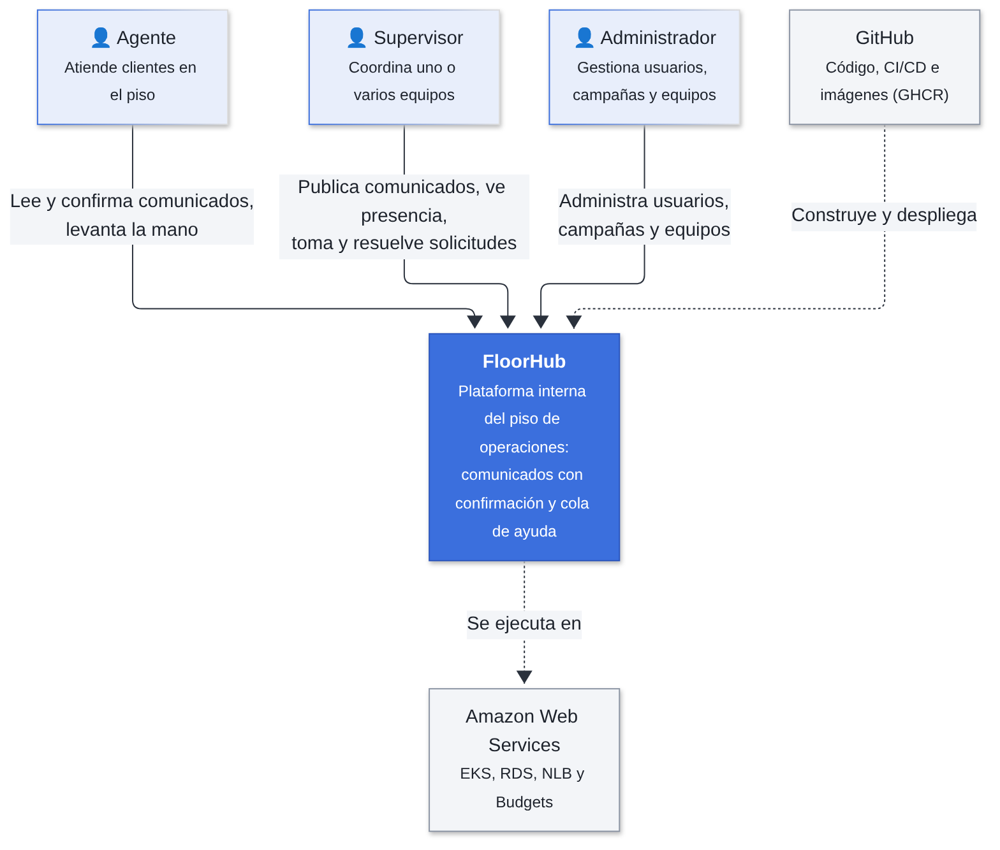
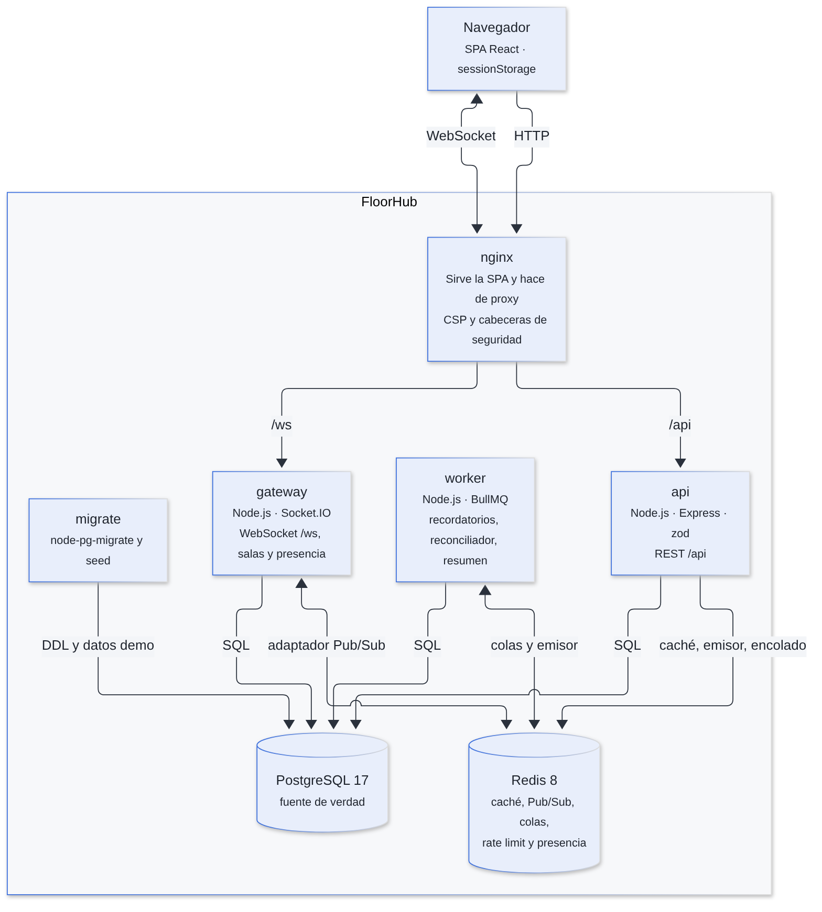
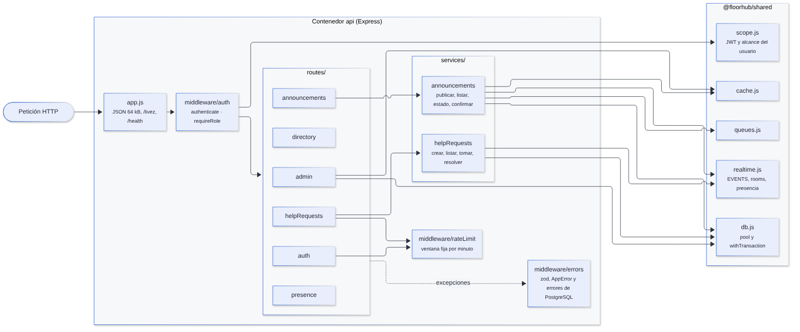
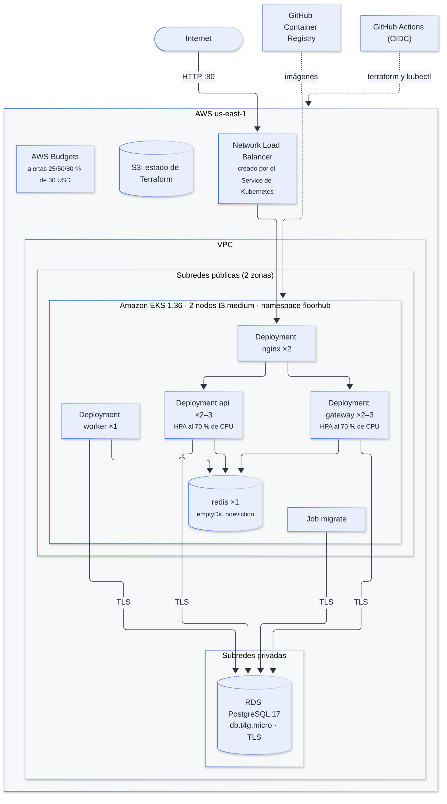

# Arquitectura de Software, Modelo C4 y Backend Node.js

## 1. Visión general del backend

FloorHub es un **monorepo de Node.js** (npm workspaces) con tres procesos de backend que comparten un paquete común. Cada proceso tiene su propia imagen de Docker y escala por separado.

| Proceso | Tecnología | Responsabilidad | Puerto / ruta |
|---|---|---|---|
| `api` | Express 5, zod, bcrypt, jsonwebtoken | API REST: autenticación, administración, comunicados, cola de ayuda, presencia | 3000, publicado en `/api` |
| `gateway` | Socket.IO con adaptador de Redis | Conexiones WebSocket, salas por usuario y equipo, presencia | 3000, publicado en `/ws` |
| `worker` | BullMQ | Recordatorios, reconciliador, barrido de presencia y resumen diario | 3000 (solo `/health`) |
| `migrate` | node-pg-migrate | Migraciones y datos de demostración; se ejecuta y termina | — |
| `nginx` | Nginx | Sirve la SPA de React y hace de proxy de `/api` y `/ws` | 8080 |

### Características fundamentales del diseño

- **PostgreSQL es la fuente de verdad.** Todo lo que vive en Redis (caché, colas, presencia) se puede reconstruir desde PostgreSQL.
- **Efectos después del commit.** La API guarda en una transacción y, solo después del `COMMIT`, invalida la caché, emite eventos y encola trabajos. Así nunca se notifica algo que luego se revirtió.
- **La API no tiene sockets propios.** Publica eventos en Redis con `@socket.io/redis-emitter` y cada réplica del gateway los entrega a sus clientes.
- **Servicios sin estado.** Cualquier réplica puede atender cualquier petición, lo que permite el autoescalado horizontal.
- **Degradación controlada.** Si Redis falla, la API sigue respondiendo desde PostgreSQL (estado `degraded` en `/health`); solo PostgreSQL es indispensable.

## 2. Estructura de capas y paquetes

```text
FloorHub/
├── apps/
│   ├── api/src/
│   │   ├── app.js               # Composición de Express, /livez y /health
│   │   ├── index.js             # Arranque y apagado limpio (SIGTERM)
│   │   ├── middleware/          # auth (JWT y rol), rateLimit, errors
│   │   ├── routes/              # auth, admin, announcements, helpRequests, directory, presence
│   │   ├── services/            # Lógica y SQL: announcements, helpRequests, auth, campaigns, teams, users, directory, presence
│   │   ├── validation.js        # Esquemas zod reutilizables
│   │   └── errors.js            # AppError, notFound, forbidden, conflict
│   ├── gateway/src/server.js    # Socket.IO: autenticación, salas y presencia
│   ├── worker/src/jobs.js       # sendReminder, reconcileReminders, sweepPresence, dailySummary
│   └── web/src/                 # React con Vite (ver documento 03)
├── packages/shared/src/
│   ├── config.js                # Variables de entorno validadas con zod
│   ├── context.js               # Pool de pg, dos conexiones de Redis, emisor, colas y logger
│   ├── db.js                    # Pool y withTransaction
│   ├── cache.js                 # getOrSet con TTL e invalidación
│   ├── scope.js                 # JWT y alcance del usuario (equipos y campañas)
│   ├── queues.js                # Colas de BullMQ y jobId determinista
│   └── realtime.js              # Nombres de eventos, salas y presencia
├── db/
│   ├── migrations/001_initial_schema.sql
│   └── src/                     # migrate.js, seed.js, cli.js
└── deploy/                      # docker, k8s (Kustomize) y terraform
```

**Flujo de una petición REST:** `app.js` → `authenticate` (JWT y alcance) → `requireRole` → ruta (valida con zod) → servicio (SQL con parámetros y transacción) → efectos en segundo plano → `errorHandler` traduce cualquier excepción a una respuesta JSON.

## 3. Modelo C4 — Diagramas de arquitectura

Las fuentes de todos los diagramas están en [`diagramas/fuentes`](diagramas/fuentes) en formato Mermaid.

### 3.1. Nivel 1: diagrama de contexto del sistema

Muestra a FloorHub como una caja negra, sus tres tipos de usuario y los sistemas externos con los que se relaciona.



### 3.2. Nivel 2: diagrama de contenedores



| Contenedor | Se comunica con | Protocolo | Para qué |
|---|---|---|---|
| Navegador | nginx | HTTP y WebSocket | Descarga la SPA, llama a la API y recibe eventos |
| nginx | api, gateway | HTTP (proxy) | Enruta `/api` y `/ws`; agrega CSP y cabeceras de seguridad |
| api | PostgreSQL | SQL (TLS en AWS) | Lee y escribe todos los datos |
| api | Redis | RESP | Caché, rate limiting, emisión de eventos y encolado de trabajos |
| gateway | Redis | RESP (Pub/Sub) | Recibe eventos de la API y del worker y guarda la presencia |
| gateway | PostgreSQL | SQL | Carga el alcance del usuario al autenticar el socket |
| worker | PostgreSQL y Redis | SQL y RESP | Procesa trabajos y reconstruye colas desde PostgreSQL |

### 3.3. Nivel 3: diagrama de componentes (contenedor `api`)



### 3.4. Nivel 4: diagrama de despliegue en AWS



| Recurso | Configuración | Motivo |
|---|---|---|
| Amazon EKS 1.36 | Soporte estándar | El soporte extendido cuesta 6 veces más |
| 2 nodos EC2 `t3.medium` | Bajo demanda, subredes públicas | Spot podría retirar un nodo durante la presentación; las subredes públicas evitan el NAT Gateway |
| RDS PostgreSQL 17 `db.t4g.micro` | Single-AZ, subredes privadas, TLS con CA verificada | Lo más pequeño adecuado |
| Network Load Balancer | Creado por el Service `LoadBalancer` con anotación `nlb` | No requiere instalar un controlador adicional |
| Redis | Pod dentro del clúster, `emptyDir` | Evita costos de ElastiCache y volúmenes huérfanos |
| GHCR | Paquetes públicos | Las imágenes existen aunque el stack de AWS esté destruido |
| Terraform | Stacks `bootstrap` (permanente) y `demo` (efímero) | El presupuesto y sus alertas sobreviven a `make destroy` |

### 3.5. Comunicación en tiempo real

```text
api ──(COMMIT)──► emitter.to(sala).emit(evento) ──► Redis Pub/Sub ──► gateway réplica 1 ──► sockets
                                                                  └─► gateway réplica 2 ──► sockets
```

- **Solo transporte WebSocket.** El *long-polling* exigiría sesiones pegajosas entre réplicas; un WebSocket es una sola conexión TCP.
- **Al reconectar, el cliente vuelve a pedir el estado por REST.** Redis Pub/Sub no guarda mensajes: lo emitido durante un corte se pierde, y PostgreSQL permite recuperarlo.
- **Salas según el JWT.** Al conectar, cada socket entra solo a las salas que le corresponden:

| Rol | Salas |
|---|---|
| Agente | `user:{id}` y `team:{id}` de su equipo |
| Supervisor | `user:{id}` y `team:{id}:supervisors` de cada equipo que supervisa |
| Administrador | `user:{id}` |

## 4. Principios de diseño aplicados

El backend no usa clases de servicio sino **módulos con funciones** que reciben un `context` (pool, Redis, caché, emisor, colas y logger). Los principios SOLID se aplican de esta forma:

| Principio | Cómo se aplica en FloorHub | Ejemplo en el código |
|---|---|---|
| **S** — Responsabilidad única | Rutas validan y responden; servicios aplican reglas; middleware resuelve autenticación, límites y errores | `routes/helpRequests.js` solo valida con zod y llama a `services/helpRequests.js` |
| **O** — Abierto/cerrado | Un rol nuevo o un tipo de ayuda nuevo se agrega en tablas de configuración, sin tocar la lógica | `PRIORITY_BY_TYPE`, `VIEWS` en `App.jsx`, `PG_ERRORS` en `middleware/errors.js` |
| **L** — Sustitución | Cualquier objeto que cumpla la interfaz del `context` sirve: en pruebas se usa un contexto real con base y Redis exclusivos | `test/helpers.js` |
| **I** — Segregación de interfaces | Cada función recibe solo lo que usa del contexto mediante desestructuración | `presenceRoutes({ pool, redis, log })` |
| **D** — Inversión de dependencias | Los servicios no crean conexiones: las reciben en el `context`, construido una sola vez en `shared/context.js` | `publishAnnouncement(context, user, input)` |

## 5. Consistencia transaccional y trabajos asíncronos

FloorHub no necesita un patrón Saga porque cada operación de negocio vive en **una sola base de datos** y cabe en una transacción. La consistencia se logra así:

| Problema | Solución | Dónde |
|---|---|---|
| Publicar debe crear el comunicado, sus destinos y su audiencia, o nada | `withTransaction` con `BEGIN`/`COMMIT`/`ROLLBACK` | `publishAnnouncement` |
| Notificar algo que luego se revierte | Los efectos (caché, eventos, colas) van en `context.background` después del commit | `publishAnnouncement`, `acknowledgeAnnouncement` |
| Dos supervisores toman la misma solicitud | `UPDATE … WHERE status = 'pending'` atómico | `claimRequest` |
| Un trabajo de recordatorio se ejecuta dos veces | `SELECT … FOR UPDATE` y comparación del número de ronda | `sendReminder` |
| Redis se reinicia y pierde trabajos con retraso | Reconciliador cada 60 s que reencola desde `next_reminder_at`, con `jobId` determinista | `reconcileReminders` |

**Trabajos programados del worker** (registrados con `upsertJobScheduler` al arrancar):

| Trabajo | Frecuencia | Qué hace |
|---|---|---|
| `reconcile-reminders` | Cada 60 s | Reencola recordatorios vencidos desde PostgreSQL |
| `sweep-presence` | Cada 15 s | Expira la presencia de quien dejó de enviar heartbeats (45 s) |
| `daily-summary` | `0 23 * * *` | Escribe en los logs el resumen de las últimas 24 h |
| `send-reminder` | Con retraso por comunicado | Envía una ronda de recordatorios (máximo 5) |
| `notify` | Bajo demanda | Entrega cada notificación al socket del agente |

Los trabajos se reintentan 3 veces con espera exponencial (2 s, 4 s, 8 s).

## 6. Catálogo de endpoints de la API REST

Todas las rutas, salvo `login`, `/health` y `/livez`, exigen la cabecera `Authorization: Bearer <token>`. El contrato completo está en [api/openapi_floorhub.yaml](api/openapi_floorhub.yaml).

| Método | Ruta | Rol | Descripción | Respuestas principales |
|---|---|---|---|---|
| GET | `/livez` | Público | El proceso responde | 200 |
| GET | `/health` | Público | Estado de PostgreSQL y Redis | 200 `ok` o `degraded`, 503 |
| POST | `/api/auth/login` | Público | Inicia sesión y devuelve el JWT | 200, 400, 401, 429 |
| GET | `/api/auth/me` | Todos | Datos y alcance del usuario | 200, 401 |
| GET | `/api/admin/campaigns` | Admin | Lista campañas | 200 |
| POST | `/api/admin/campaigns` | Admin | Crea una campaña | 201, 409 |
| PATCH | `/api/admin/campaigns/{id}` | Admin | Renombra, activa o desactiva | 200, 400, 404 |
| GET | `/api/admin/teams` | Admin | Lista equipos con su campaña y supervisores (caché 300 s) | 200 |
| POST | `/api/admin/teams` | Admin | Crea un equipo en una campaña | 201, 409, 422 |
| PATCH | `/api/admin/teams/{id}` | Admin | Renombra, activa o desactiva | 200, 400, 404 |
| PUT | `/api/admin/teams/{id}/supervisors` | Admin | Reemplaza los supervisores del equipo | 200, 404 |
| GET | `/api/admin/users` | Admin | Lista usuarios | 200 |
| POST | `/api/admin/users` | Admin | Crea un usuario | 201, 409, 422 |
| PATCH | `/api/admin/users/{id}` | Admin | Edita, cambia contraseña, activa o desactiva | 200, 400, 404, 422 |
| POST | `/api/announcements` | Supervisor | Publica un comunicado | 201, 400, 403, 422 |
| GET | `/api/announcements` | Agente, Supervisor | Bandeja del agente o publicados del supervisor | 200, 403 |
| GET | `/api/announcements/{id}/status` | Supervisor | Porcentaje, confirmados y pendientes | 200, 404 |
| POST | `/api/announcements/{id}/ack` | Agente | Confirma la lectura | 200, 404 |
| POST | `/api/help-requests` | Agente | Levanta la mano | 201, 400, 409, 429 |
| GET | `/api/help-requests` | Agente, Supervisor | Propias o cola de sus equipos | 200 |
| POST | `/api/help-requests/{id}/claim` | Supervisor | Toma la solicitud | 200, 404, 409 |
| POST | `/api/help-requests/{id}/replies` | Agente, Supervisor | Envía un mensaje en la conversación (el agente dueño o quien la tomó, mientras está en atención) | 201, 400, 404, 409 |
| POST | `/api/help-requests/{id}/resolve` | Supervisor | Resuelve la solicitud | 200, 404, 409 |
| GET | `/api/directory` | Supervisor | Campañas, equipos y agentes que puede elegir como destino | 200 |
| GET | `/api/presence` | Supervisor | Agentes de sus equipos con su estado de conexión | 200 |

### Catálogo de eventos WebSocket (ruta `/ws`)

| Evento | Dirección | Sala destino | Cuándo |
|---|---|---|---|
| `announcement:new` | Servidor → cliente | `user:{agente}` | Se publica un comunicado |
| `announcement:published` | Servidor → cliente | `user:{autor}`, `team:{id}:supervisors` | Se publica un comunicado |
| `announcement:acknowledged` | Servidor → cliente | `user:{autor}`, `team:{id}:supervisors` | Un agente confirma |
| `announcement:reminder` | Servidor → cliente | `user:{agente}` | El worker envía una ronda |
| `help:created` / `help:claimed` / `help:replied` / `help:resolved` | Servidor → cliente | `team:{id}:supervisors`, `user:{agente}` | Cambia una solicitud |
| `presence:changed` | Servidor → cliente | `team:{id}:supervisors` | Un agente se conecta o se desconecta |
| `presence:heartbeat` | Cliente → servidor | — | Cada 15 s, para seguir en línea |

### Formato de error

Todas las respuestas de error tienen la misma forma y nunca revelan detalles internos:

```json
{ "error": { "code": "already_claimed", "message": "Otro supervisor ya tomó esta solicitud" } }
```

| Origen | Código HTTP | `code` |
|---|---|---|
| Validación zod | 400 | `validation_error` (con `details` por campo) |
| Token ausente o inválido | 401 | `unauthorized` |
| Rol sin permiso | 403 | `forbidden` |
| Recurso inexistente o fuera del alcance | 404 | `not_found` |
| Duplicado (PostgreSQL 23505) | 409 | `already_exists` |
| Llave foránea inválida (23503) | 422 | `invalid_reference` |
| Regla `CHECK` violada (23514) | 422 | `invalid_state` |
| Límite de intentos | 429 | `rate_limited` |
| Error no controlado | 500 | `internal_error` (se registra en el log) |

## 7. Decisiones técnicas

| Decisión | Por qué |
|---|---|
| `UPDATE … WHERE status = 'pending'` para tomar solicitudes | PostgreSQL bloquea la fila y el segundo supervisor actualiza 0 filas. No hace falta un candado en Redis. |
| Destinatarios guardados al publicar | El porcentaje y la auditoría no cambian si un agente se muda de equipo. |
| Token en `sessionStorage` | Cada ventana tiene su sesión, lo que permite la demo con varios usuarios en un navegador. El riesgo ante XSS se mitiga con React y la CSP. |
| JWT de 8 h sin refresh tokens | Dura un turno. Un usuario desactivado se bloquea al validar su estado en cada petición. |
| Redis con política `noeviction` | BullMQ la exige; por eso toda clave de caché lleva TTL corto. |
| Dos conexiones de Redis | La de caché falla rápido; la de colas reintenta sin límite. |
| `CMD ["node", …]` en lugar de `npm` | Node recibe `SIGTERM` directamente y cierra limpio. |
