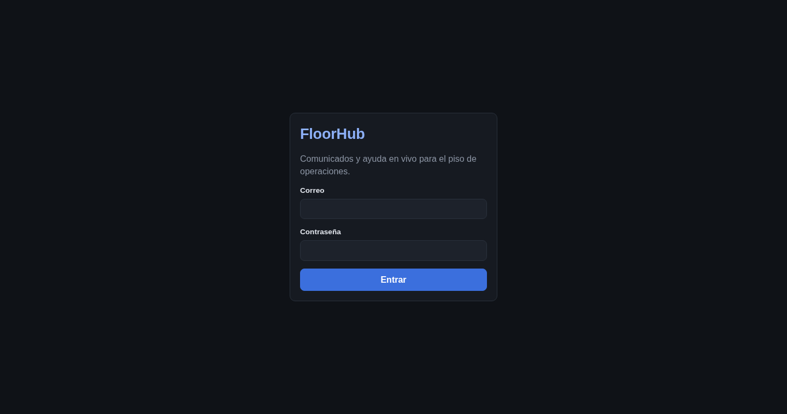
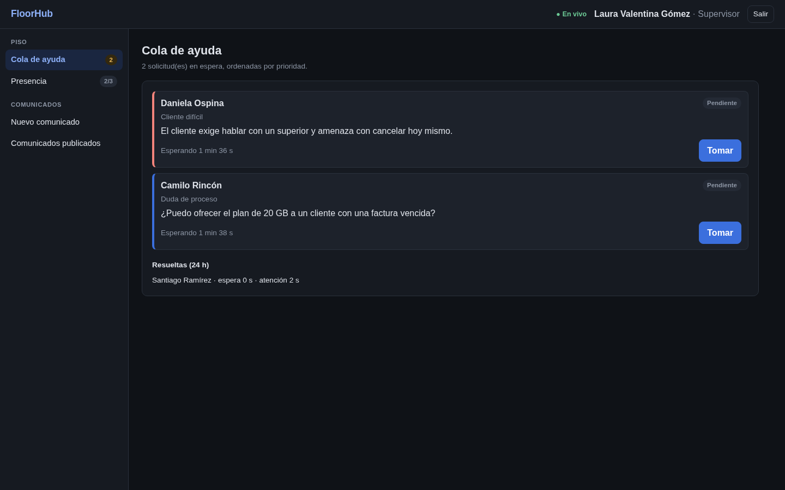
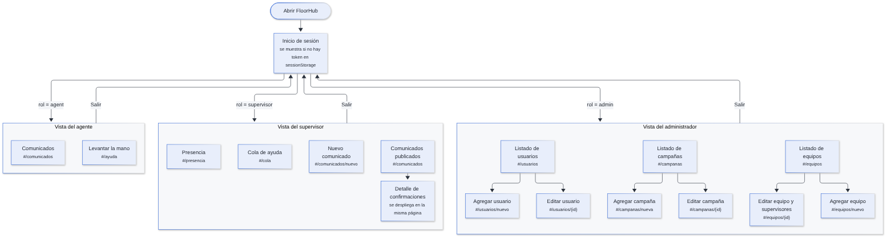

# Arquitectura del Frontend y Gestión de Roles de Usuario

## 1. Arquitectura de la interfaz de usuario

El frontend es una **SPA (Single Page Application)** de React construida con Vite. Nginx la sirve como archivos estáticos y, en el mismo origen, hace de proxy hacia la API (`/api`) y el gateway (`/ws`). Por eso el navegador no necesita CORS.

### 1.1. Stack tecnológico

| Necesidad | Tecnología | Versión | Motivo |
|---|---|---|---|
| Interfaz | React | 19 | Componentes y escape automático de contenido (mitiga XSS) |
| Empaquetado | Vite | 8 | Compilación rápida y build estático para Nginx |
| Tiempo real | socket.io-client | 4.8 | Reconexión automática; solo transporte WebSocket |
| Enrutado | Hash (`#/ruta`) propio, en `router.js` | — | No requiere configuración en Nginx y cada ventana conserva su página |
| Estilos | CSS propio con variables (`styles.css`) | — | Tema oscuro de bajo contraste sin dependencias |
| Sesión | `sessionStorage` | — | Una sesión independiente por ventana |

### 1.2. Vista previa de la interfaz

| Inicio de sesión | Cola de ayuda (supervisor) |
|---|---|
|  |  |

## 2. Estructura de directorios del frontend (`apps/web/src/`)

```text
apps/web/src/
├── main.jsx            # Punto de entrada: monta <App />
├── App.jsx             # Restaura la sesión, elige la vista según el rol y muestra los avisos
├── api.js              # fetch a /api con el token; cierra sesión ante un 401
├── useSocket.js        # Conexión a /ws, heartbeat cada 15 s y recarga al reconectar
├── router.js           # useHashRoute, href y navigate
├── format.js           # Fechas, duraciones y etiquetas en español
├── styles.css          # Variables de color, componentes y diseño adaptable (< 860 px)
├── components/
│   ├── Shell.jsx       # Menú lateral por secciones, usuario y botón «Salir»
│   ├── SearchSelect.jsx# Selector con buscador, sin distinción de tildes ni mayúsculas
│   ├── Tick.jsx        # Tiempo transcurrido que avanza solo cada segundo
│   └── Toasts.jsx      # Avisos temporales (6 s)
└── views/
    ├── LoginView.jsx
    ├── AgentView.jsx
    ├── SupervisorView.jsx
    └── AdminView.jsx
```

**Ciclo de vida de la sesión:**

1. Al iniciar sesión, `LoginView` guarda el token en `sessionStorage` y pide `GET /api/auth/me`.
2. `App.jsx` elige la vista con el mapa `VIEWS = { agent, supervisor, admin }`.
3. Si cualquier petición responde **401**, `api.js` llama al manejador que borra el token y vuelve al inicio de sesión.
4. `useSocket` conecta a `/ws` enviando el token en el *handshake*. En cada evento `connect` (también al reconectar) la vista vuelve a pedir su estado por REST, porque los eventos emitidos durante un corte se pierden.

## 3. Matriz de roles y permisos (RBAC)

El rol se guarda en `users.role` y se verifica **en el servidor** en cada petición (`requireRole`) y al entrar a las salas de WebSocket. Ocultar un botón en la interfaz es solo comodidad, no seguridad.

| Acción | Agente | Supervisor | Administrador |
|---|:---:|:---:|:---:|
| Iniciar y cerrar sesión | ✅ | ✅ | ✅ |
| Ver sus comunicados y confirmar lectura | ✅ | — | — |
| Levantar la mano y seguir su solicitud | ✅ | — | — |
| Publicar comunicados (solo a sus equipos y campañas) | — | ✅ | — |
| Ver el porcentaje de confirmación | — | ✅ | — |
| Ver la cola de ayuda de sus equipos, tomar y resolver | — | ✅ | — |
| Ver la presencia de sus agentes | — | ✅ | — |
| Gestionar usuarios, campañas, equipos y supervisores | — | — | ✅ |

### Reglas de visibilidad

| Rol | Comunicados | Solicitudes de ayuda |
|---|---|---|
| Agente | Aquellos en los que es destinatario y no han vencido | Las propias (resueltas, solo las de las últimas 24 h) |
| Supervisor | Los propios y los que alcanzan a agentes de sus equipos | Las de sus equipos |
| Administrador | No participa en la operación diaria | No participa en la operación diaria |

Un supervisor solo ve en el detalle de un comunicado ajeno a los agentes de **sus** equipos; el autor ve a toda la audiencia.

## 4. Mapa de navegación



### 4.1. Vista pública (sin autenticación)

| Página | Ruta | Contenido |
|---|---|---|
| Inicio de sesión | (sin hash) | Correo, contraseña y botón para entrar |

### 4.2. Vistas protegidas por rol

| Rol | Página | Ruta | Contenido |
|---|---|---|---|
| Agente | Comunicados | `#/comunicados` | Bandeja con los comunicados sin confirmar primero y luego los más recientes, botón «Leí y entendí» y aviso de recordatorio |
| Agente | Levantar la mano | `#/ayuda` | Formulario (tipo y resumen), estado de la solicitud activa y «Resueltas recientemente» |
| Supervisor | Cola de ayuda | `#/cola` | Pendientes por prioridad y antigüedad con espera en vivo, «Tomar», «Resolver» y «Resueltas (24 h)» |
| Supervisor | Presencia | `#/presencia` | Agentes de sus equipos con estado conectado o desconectado |
| Supervisor | Nuevo comunicado | `#/comunicados/nuevo` | Título, cuerpo, prioridad, intervalo de recordatorio y destinos con buscador |
| Supervisor | Comunicados publicados | `#/comunicados` | Lista con porcentaje; al desplegar uno, confirmados y pendientes con su número de recordatorios |
| Administrador | Usuarios | `#/usuarios`, `#/usuarios/nuevo`, `#/usuarios/{id}` | Listado con filtro por rol y búsqueda; alta y edición |
| Administrador | Campañas | `#/campanas`, `#/campanas/nueva`, `#/campanas/{id}` | Listado, alta y edición |
| Administrador | Equipos | `#/equipos`, `#/equipos/nuevo`, `#/equipos/{id}` | Listado, alta y edición con asignación de supervisores y lista de agentes |

Si la ruta no existe para el rol, la vista abre su página por defecto (`comunicados`, `cola` o `usuarios`).

## 5. Indicadores en vivo del menú

El menú lateral (`Shell.jsx`) muestra contadores que se actualizan con los eventos del socket:

| Rol | Página | Contador |
|---|---|---|
| Agente | Comunicados | Comunicados críticos sin confirmar (rojo) |
| Agente | Levantar la mano | Estado de la solicitud activa: «Pendiente» o «En atención» |
| Supervisor | Cola de ayuda | Solicitudes pendientes |
| Supervisor | Presencia | Conectados sobre el total, por ejemplo `2/3` |

Además, un indicador de conexión avisa si el WebSocket se cayó.

## 6. Accesibilidad y diseño adaptable

- **Selectores con buscador** (`SearchSelect`): se usan con teclado, tienen roles ARIA y filtran sin distinguir tildes («Tecnico» encuentra «Técnico»).
- **Estados con texto además del color:** «Crítico», «Pendiente», «En atención», «Activo» e «Inactivo» se leen aunque no se distinga el color.
- **Diseño adaptable:** por debajo de 860 px el menú lateral pasa a ser horizontal.
- **Textos en español** en toda la interfaz y en los mensajes de error de la API.

## 7. Seguridad en el cliente

| Riesgo | Mitigación |
|---|---|
| XSS que robe el token de `sessionStorage` | React escapa el contenido y Nginx envía una CSP `default-src 'self'` que bloquea scripts externos |
| Clickjacking | `X-Frame-Options: DENY` y `frame-ancestors 'none'` |
| Token vencido o usuario desactivado | La API responde 401 y la SPA cierra la sesión automáticamente |
| Mezcla de sesiones entre usuarios | `sessionStorage` es independiente por ventana |
