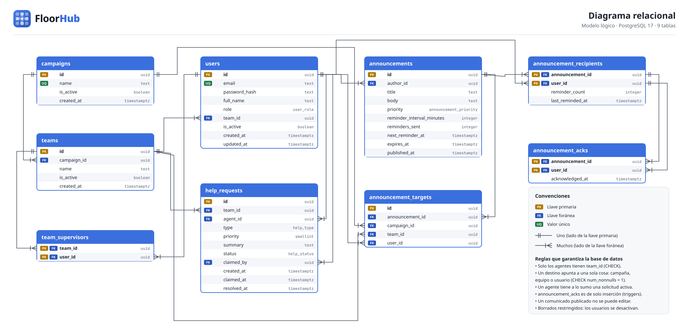
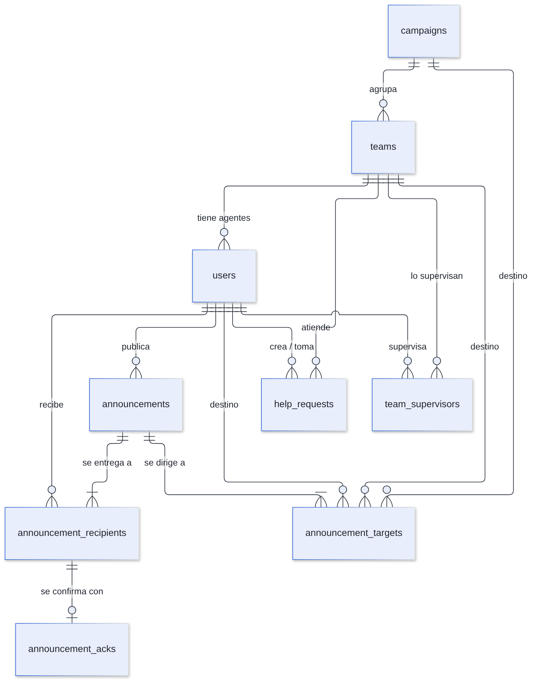
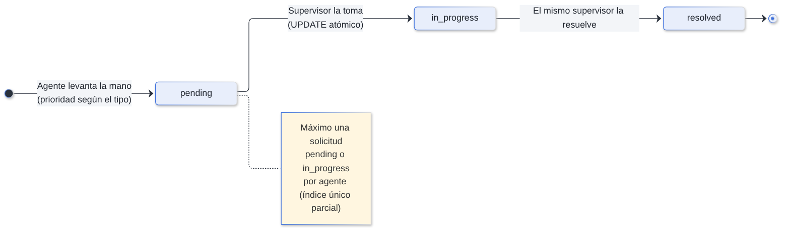

# Diseño, Estructura y Esquema de Base de Datos Relacional

**Motor:** PostgreSQL 17 · **Migración:** `db/migrations/001_initial_schema.sql` · **Herramienta:** node-pg-migrate

## 1. Diseño arquitectónico de la base de datos

### Principios de diseño aplicados

1. **La base garantiza las reglas, no solo la aplicación.** Las reglas críticas viven en `CHECK`, llaves foráneas, índices únicos parciales y triggers. Si la API tuviera un error, la base seguiría rechazando el dato inválido.
2. **Fuente de verdad única.** Todo lo que está en Redis se puede reconstruir desde aquí.
3. **Auditoría de solo inserción.** Una confirmación de lectura no se puede editar ni borrar.
4. **Nada se borra.** Las llaves foráneas usan `ON DELETE RESTRICT` y los usuarios, equipos y campañas se desactivan con `is_active`.
5. **Mínimo privilegio.** La aplicación se conecta con `floorhub_app`, que solo tiene los permisos que usa; las migraciones usan el rol dueño `floorhub_owner`.
6. **Identificadores UUID** (`gen_random_uuid()`): viajan por URL y WebSocket sin revelar cuántos registros existen.
7. **Tercera forma normal**, con una desnormalización deliberada: `announcement_recipients` guarda la audiencia como foto fija al publicar.

## 2. Modelo relacional y diagrama entidad-relación

### 2.1. Diagrama del modelo relacional



### 2.2. Notación formal del esquema relacional

Clave primaria **subrayada con PK**, clave foránea con FK.

```text
campaigns (id PK, name UK, is_active, created_at)
teams (id PK, campaign_id FK→campaigns, name, is_active, created_at)            UK(campaign_id, name)
users (id PK, email UK(lower), password_hash, full_name, role, team_id FK→teams,
       is_active, created_at, updated_at)
team_supervisors (team_id PK FK→teams, user_id PK FK→users)
announcements (id PK, author_id FK→users, title, body, priority, reminder_interval_minutes,
               reminders_sent, next_reminder_at, expires_at, published_at)
announcement_targets (id PK, announcement_id FK→announcements, campaign_id FK→campaigns,
                      team_id FK→teams, user_id FK→users)
announcement_recipients (announcement_id PK FK→announcements, user_id PK FK→users,
                         reminder_count, last_reminded_at)
announcement_acks (announcement_id PK, user_id PK, acknowledged_at)
                  FK(announcement_id, user_id)→announcement_recipients
help_requests (id PK, team_id FK→teams, agent_id FK→users, type, priority, summary, status,
               claimed_by FK→users, created_at, claimed_at, resolved_at)
```

### 2.3. Diagrama entidad-relación



El modelo conceptual en notación de Chen está en [diagramas/entidad-relacion.png](diagramas/entidad-relacion.png) y el análisis de relaciones en [08-modelo-entidad-relacion.md](08-modelo-entidad-relacion.md).

## 3. Diccionario de datos

### Tipos enumerados

| Tipo | Valores | Uso |
|---|---|---|
| `user_role` | `agent`, `supervisor`, `admin` | `users.role` |
| `announcement_priority` | `info`, `critical` | `announcements.priority` |
| `help_type` | `approval`, `difficult_customer`, `process_question` | `help_requests.type` |
| `help_status` | `pending`, `in_progress`, `resolved` | `help_requests.status` |

### 3.1. Tabla `campaigns`

Cliente o contrato del BPO (por ejemplo, *Banco del Valle*).

| Columna | Tipo | Nulo | Por defecto | Restricción | Descripción |
|---|---|---|---|---|---|
| `id` | `uuid` | No | `gen_random_uuid()` | PK | Identificador |
| `name` | `text` | No | — | `UNIQUE` | Nombre de la campaña |
| `is_active` | `boolean` | No | `true` | — | Desactivada en lugar de borrada |
| `created_at` | `timestamptz` | No | `now()` | — | Fecha de creación |

### 3.2. Tabla `teams`

Grupo de agentes dentro de una campaña.

| Columna | Tipo | Nulo | Por defecto | Restricción | Descripción |
|---|---|---|---|---|---|
| `id` | `uuid` | No | `gen_random_uuid()` | PK | Identificador |
| `campaign_id` | `uuid` | No | — | FK → `campaigns`, `RESTRICT` | Campaña a la que pertenece |
| `name` | `text` | No | — | `UNIQUE (campaign_id, name)` | Nombre, único dentro de la campaña |
| `is_active` | `boolean` | No | `true` | — | Estado |
| `created_at` | `timestamptz` | No | `now()` | — | Fecha de creación |

### 3.3. Tabla `users`

| Columna | Tipo | Nulo | Por defecto | Restricción | Descripción |
|---|---|---|---|---|---|
| `id` | `uuid` | No | `gen_random_uuid()` | PK | Identificador; es el `sub` del JWT |
| `email` | `text` | No | — | Único sobre `lower(email)` | Correo de acceso, sin distinguir mayúsculas |
| `password_hash` | `text` | No | — | — | Hash bcrypt (10 rondas); nunca se devuelve en la API |
| `full_name` | `text` | No | — | Máx. 120 (validado en la API) | Nombre visible |
| `role` | `user_role` | No | — | — | Rol |
| `team_id` | `uuid` | Sí | — | FK → `teams`; `CHECK ((role = 'agent') = (team_id IS NOT NULL))` | Equipo del agente; nulo para supervisores y administradores |
| `is_active` | `boolean` | No | `true` | — | Un usuario inactivo no puede iniciar sesión |
| `created_at` / `updated_at` | `timestamptz` | No | `now()` | — | Auditoría de cambios |

### 3.4. Tabla `team_supervisors`

Relación muchos a muchos: un supervisor puede tener varios equipos y un equipo varios supervisores.

| Columna | Tipo | Nulo | Restricción | Descripción |
|---|---|---|---|---|
| `team_id` | `uuid` | No | PK, FK → `teams` | Equipo |
| `user_id` | `uuid` | No | PK, FK → `users` | Supervisor (la API verifica que tenga rol `supervisor`) |

### 3.5. Tabla `announcements`

| Columna | Tipo | Nulo | Por defecto | Restricción | Descripción |
|---|---|---|---|---|---|
| `id` | `uuid` | No | `gen_random_uuid()` | PK | Identificador |
| `author_id` | `uuid` | No | — | FK → `users` | Supervisor que publicó |
| `title` | `text` | No | — | Entre 1 y 200 caracteres | Título; inmutable |
| `body` | `text` | No | — | Entre 1 y 5 000 caracteres | Contenido; inmutable |
| `priority` | `announcement_priority` | No | — | — | `info` o `critical` |
| `reminder_interval_minutes` | `integer` | Sí | — | `> 0`; obligatorio si y solo si es `critical` | Minutos entre recordatorios (la API acepta de 1 a 240) |
| `reminders_sent` | `integer` | No | `0` | — | Rondas enviadas (máximo 5) |
| `next_reminder_at` | `timestamptz` | Sí | — | — | Próxima ronda; `NULL` si ya no aplica |
| `expires_at` | `timestamptz` | Sí | — | — | Fecha de vencimiento opcional |
| `published_at` | `timestamptz` | No | `now()` | — | Fecha de publicación; inmutable |

### 3.6. Tabla `announcement_targets`

Lo que **eligió** el supervisor como destino.

| Columna | Tipo | Nulo | Restricción | Descripción |
|---|---|---|---|---|
| `id` | `uuid` | No | PK | Identificador |
| `announcement_id` | `uuid` | No | FK → `announcements` | Comunicado |
| `campaign_id` | `uuid` | Sí | FK → `campaigns` | Destino de tipo campaña |
| `team_id` | `uuid` | Sí | FK → `teams` | Destino de tipo equipo |
| `user_id` | `uuid` | Sí | FK → `users` | Destino de tipo agente |

`CHECK (num_nonnulls(campaign_id, team_id, user_id) = 1)`: cada fila es exactamente un tipo de destino.

### 3.7. Tabla `announcement_recipients`

A quiénes **alcanzó** el comunicado en el momento de publicarlo (agentes activos).

| Columna | Tipo | Nulo | Por defecto | Restricción | Descripción |
|---|---|---|---|---|---|
| `announcement_id` | `uuid` | No | — | PK, FK → `announcements` | Comunicado |
| `user_id` | `uuid` | No | — | PK, FK → `users` | Agente destinatario |
| `reminder_count` | `integer` | No | `0` | — | Recordatorios recibidos |
| `last_reminded_at` | `timestamptz` | Sí | — | — | Último recordatorio |

### 3.8. Tabla `announcement_acks`

Registro de auditoría de solo inserción.

| Columna | Tipo | Nulo | Por defecto | Restricción | Descripción |
|---|---|---|---|---|---|
| `announcement_id` | `uuid` | No | — | PK | Comunicado |
| `user_id` | `uuid` | No | — | PK | Agente que confirmó |
| `acknowledged_at` | `timestamptz` | No | `now()` | — | Fecha y hora de «Leí y entendí» |

La llave foránea compuesta `(announcement_id, user_id)` apunta a `announcement_recipients`: **la base rechaza la confirmación de quien no era destinatario.**

### 3.9. Tabla `help_requests`

| Columna | Tipo | Nulo | Por defecto | Restricción | Descripción |
|---|---|---|---|---|---|
| `id` | `uuid` | No | `gen_random_uuid()` | PK | Identificador |
| `team_id` | `uuid` | No | — | FK → `teams` | Equipo del agente al crearla |
| `agent_id` | `uuid` | No | — | FK → `users` | Agente que levantó la mano |
| `type` | `help_type` | No | — | — | Tipo de ayuda |
| `priority` | `smallint` | No | — | — | 3, 2 o 1; la fija el servidor |
| `summary` | `text` | No | — | Entre 1 y 500 caracteres | Resumen en una línea |
| `status` | `help_status` | No | `'pending'` | Ver regla de estados | Estado |
| `claimed_by` | `uuid` | Sí | — | FK → `users` | Supervisor responsable |
| `created_at` | `timestamptz` | No | `now()` | — | Creación |
| `claimed_at` | `timestamptz` | Sí | — | — | Cuándo se tomó |
| `resolved_at` | `timestamptz` | Sí | — | — | Cuándo se resolvió |

**Regla de estados** (`help_requests_state_is_consistent`): cada estado exige exactamente sus datos.

| Estado | `claimed_by` | `claimed_at` | `resolved_at` |
|---|---|---|---|
| `pending` | `NULL` | `NULL` | `NULL` |
| `in_progress` | obligatorio | obligatorio | `NULL` |
| `resolved` | obligatorio | obligatorio | obligatorio |

Los tiempos **no se guardan, se calculan**: espera = `claimed_at − created_at` y atención = `resolved_at − claimed_at`. Así no pueden contradecir a las columnas de las que salen.



## 4. Índices de rendimiento

| Tabla | Índice | Tipo | Consulta que acelera |
|---|---|---|---|
| `users` | `users_email_unique_idx (lower(email))` | Único sobre expresión | Login sin distinguir mayúsculas |
| `users` | `users_team_idx (team_id)` | B-tree | Agentes de un equipo |
| `teams` | `teams_campaign_idx (campaign_id)` | B-tree | Equipos de una campaña |
| `team_supervisors` | `team_supervisors_user_idx (user_id)` | B-tree | Equipos de un supervisor |
| `announcements` | `announcements_published_idx (published_at DESC)` | B-tree | Listados recientes |
| `announcements` | `announcements_author_idx (author_id)` | B-tree | Comunicados de un autor |
| `announcements` | `announcements_next_reminder_idx (next_reminder_at) WHERE next_reminder_at IS NOT NULL` | Parcial | Reconciliador de recordatorios |
| `announcement_targets` | `announcement_targets_announcement_idx` | B-tree | Destinos de un comunicado |
| `announcement_recipients` | `announcement_recipients_user_idx (user_id, announcement_id)` | B-tree compuesto | Bandeja del agente |
| `help_requests` | `help_requests_queue_idx (team_id, priority DESC, created_at) WHERE status = 'pending'` | Parcial | La cola en vivo |
| `help_requests` | `help_requests_one_active_per_agent_idx (agent_id) WHERE status IN ('pending','in_progress')` | Único parcial | Impide más de una mano levantada por agente |
| `help_requests` | `help_requests_claimed_by_idx (claimed_by, status)` | B-tree | Solicitudes en atención de un supervisor |

## 5. Triggers y permisos

### 5.1. Triggers de auditoría

| Trigger | Tabla | Evento | Efecto |
|---|---|---|---|
| `announcement_acks_no_change` | `announcement_acks` | `BEFORE UPDATE OR DELETE` (por fila) | Lanza `restrict_violation` |
| `announcement_acks_no_truncate` | `announcement_acks` | `BEFORE TRUNCATE` | Lanza `restrict_violation` |
| `announcements_immutable_content` | `announcements` | `BEFORE UPDATE OF title, body, priority, author_id, published_at` | Impide cambiar lo que el agente confirmó haber leído |

Los triggers actúan **incluso para el dueño de las tablas**; lo comprueba la prueba «los triggers lo impiden incluso al dueño de las tablas».

### 5.2. Permisos del rol de la aplicación (`floorhub_app`)

| Tabla | `SELECT` | `INSERT` | `UPDATE` | `DELETE` |
|---|:---:|:---:|:---:|:---:|
| `campaigns`, `teams`, `users`, `help_requests` | ✅ | ✅ | ✅ | — |
| `team_supervisors` | ✅ | ✅ | — | ✅ |
| `announcements` | ✅ | ✅ | Solo `reminders_sent`, `next_reminder_at` | — |
| `announcement_targets` | ✅ | ✅ | — | — |
| `announcement_recipients` | ✅ | ✅ | Solo `reminder_count`, `last_reminded_at` | — |
| `announcement_acks` | ✅ | ✅ | — | — |

## 6. Scripts de inicialización

| Script | Comando | Qué hace |
|---|---|---|
| Migraciones | `make migrate` o `node db/src/cli.js migrate` | Aplica `001_initial_schema.sql` con el rol dueño y crea el rol `floorhub_app` |
| Datos de demostración | `make seed` o `node db/src/cli.js seed` | Inserta 2 campañas, 3 equipos y 13 usuarios; es idempotente (`ON CONFLICT … DO UPDATE`) |
| Ambos | `node src/cli.js all` | Lo usa el contenedor y el Job `migrate` |

**Datos de demostración:**

| Campaña | Equipo | Supervisor | Agentes |
|---|---|---|---|
| Telecomunicaciones Andina | Retención | Laura Valentina Gómez | Santiago Ramírez, Daniela Ospina, Camilo Rincón |
| Telecomunicaciones Andina | Soporte técnico | Julián Andrés Herrera | Valentina Muñoz, Sebastián Cárdenas, Mariana López |
| Banco del Valle | Tarjetas | Paola Andrea Castaño | Felipe Arango, Natalia Quintero, Juan David Mejía |

El administrador es Andrés Felipe Morales. En local, la contraseña de todos es `Demo-FloorHub-2026`; en AWS sale de un Secret de Kubernetes.

## 7. Consultas clave de la aplicación

### 7.1. Foto fija de la audiencia al publicar

```sql
INSERT INTO announcement_recipients (announcement_id, user_id)
SELECT $1::uuid, u.id
  FROM users u
  JOIN teams t ON t.id = u.team_id
 WHERE u.role = 'agent' AND u.is_active
   AND (u.id = ANY($4::uuid[]) OR t.id = ANY($3::uuid[]) OR t.campaign_id = ANY($2::uuid[]))
RETURNING user_id;
```

Un agente que aparece por varios caminos (su campaña y su equipo) se inserta una sola vez gracias a la clave primaria compuesta.

### 7.2. Tomar una solicitud de forma atómica

```sql
UPDATE help_requests
   SET status = 'in_progress', claimed_by = $1, claimed_at = now()
 WHERE id = $2
   AND status = 'pending'
   AND team_id = ANY($3)   -- los equipos del supervisor
RETURNING id;
```

Si dos supervisores lo ejecutan a la vez, PostgreSQL bloquea la fila para el segundo. Cuando el primero confirma, el segundo vuelve a evaluar el `WHERE`, ya no encuentra `pending` y actualiza 0 filas; la API responde `409 already_claimed`.

### 7.3. Confirmación idempotente

```sql
INSERT INTO announcement_acks (announcement_id, user_id) VALUES ($1, $2)
ON CONFLICT (announcement_id, user_id) DO NOTHING
RETURNING acknowledged_at;
```

Confirmar dos veces no duplica la fila ni cambia la fecha original.

## 8. Limitación conocida

El administrador de la base (superusuario) podría desactivar los triggers. Una auditoría a prueba de ese caso necesitaría firmas o una cadena de hashes, algo fuera del alcance del MVP.
