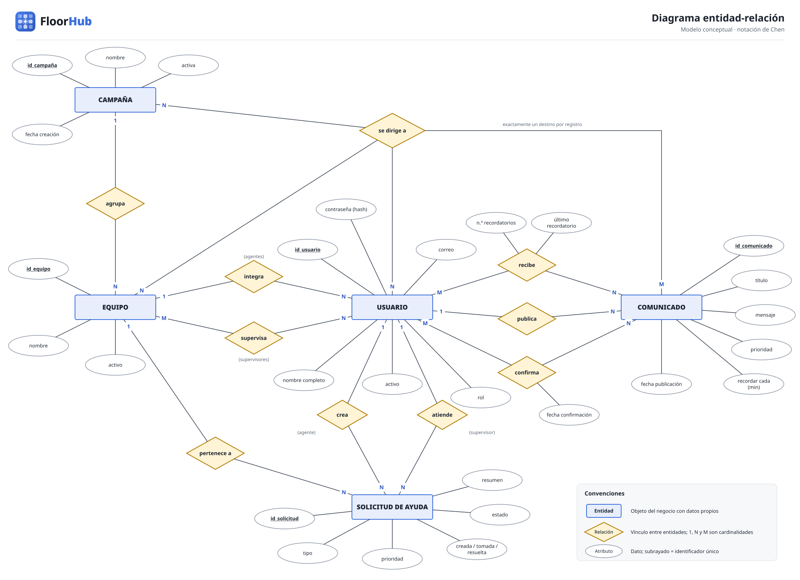
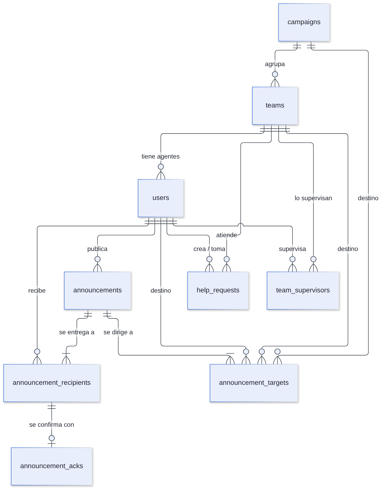
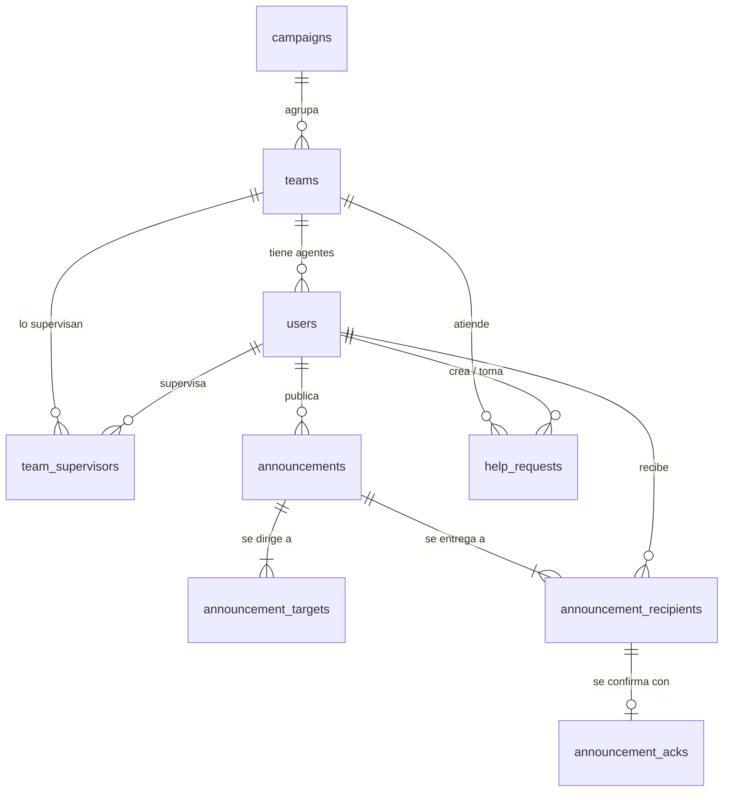

# Modelo Entidad-Relación (DER) — FloorHub

## 1. Resumen

| Elemento | Cantidad |
|---|---:|
| Entidades conceptuales | 5: Campaña, Equipo, Usuario, Comunicado y Solicitud de ayuda |
| Tablas físicas | 9 |
| Tipos enumerados | 4 |
| Llaves foráneas | 15 (todas con `ON DELETE RESTRICT`) |
| Restricciones `CHECK` de negocio | 4 |
| Triggers | 3 |

Las 4 tablas restantes resuelven relaciones: `team_supervisors` (muchos a muchos), `announcement_targets` (destinos elegidos), `announcement_recipients` (audiencia) y `announcement_acks` (confirmaciones).

## 2. Diagramas

### 2.1. Modelo conceptual (notación de Chen)



### 2.2. Diagrama de patas de gallo (tablas físicas)



Fuente: [`diagramas/fuentes/der.mmd`](diagramas/fuentes/der.mmd). Este mismo diagrama en Mermaid se dibuja directamente en GitHub:



## 3. Relaciones

| Relación | Cardinalidad | Implementación | Significado |
|---|---|---|---|
| Campaña agrupa Equipos | 1 : N | `teams.campaign_id` | Todo equipo pertenece a una campaña |
| Equipo tiene Agentes | 1 : N | `users.team_id` | Un agente está en un solo equipo |
| Supervisor supervisa Equipos | N : M | `team_supervisors` | Un supervisor puede tener varios equipos y un equipo varios supervisores |
| Usuario publica Comunicados | 1 : N | `announcements.author_id` | El autor es un supervisor |
| Comunicado se dirige a Destinos | 1 : N (mín. 1) | `announcement_targets` | Cada destino es una campaña, un equipo o un agente |
| Comunicado se entrega a Agentes | N : M | `announcement_recipients` | Audiencia calculada al publicar |
| Destinatario confirma | 1 : 0..1 | `announcement_acks` | Cada destinatario confirma como máximo una vez |
| Equipo atiende Solicitudes | 1 : N | `help_requests.team_id` | La solicitud va a la cola del equipo |
| Agente crea Solicitudes | 1 : N | `help_requests.agent_id` | Máximo una activa a la vez |
| Supervisor toma Solicitudes | 1 : N (opcional) | `help_requests.claimed_by` | Nulo mientras está pendiente |

### 3.1. Relaciones condicionadas por el rol

PostgreSQL no puede exigir en una llave foránea que el usuario referenciado tenga cierto rol. Estas reglas se garantizan así:

| Regla | Garantía |
|---|---|
| Solo los agentes tienen `team_id` | `CHECK ((role = 'agent') = (team_id IS NOT NULL))` |
| Solo supervisores en `team_supervisors` | Verificación en `PUT /api/admin/teams/{id}/supervisors` |
| Solo agentes activos en la audiencia | El `INSERT … SELECT` filtra `role = 'agent' AND is_active` |
| Solo supervisores publican y toman | `requireRole('supervisor')` en la API |

### 3.2. Relación polimórfica de destinos

`announcement_targets` apunta a tres tablas distintas con tres columnas que pueden ser nulas, y una restricción exige que exactamente una tenga valor:

```sql
CHECK (num_nonnulls(campaign_id, team_id, user_id) = 1)
```

Se prefirió a una columna genérica `target_id` + `target_type` porque así **cada columna conserva su llave foránea** y la base sigue validando que el destino exista.

## 4. Observaciones de diseño

| Observación | Justificación |
|---|---|
| **Destinos y destinatarios están separados.** | `announcement_targets` guarda la intención («Campaña X»); `announcement_recipients` guarda el resultado en ese momento. Si un agente cambia de equipo después, el porcentaje y la auditoría no cambian. |
| **La FK de `announcement_acks` apunta a `announcement_recipients`, no a `users`.** | La propia base rechaza la confirmación de alguien que no era destinatario. |
| **`help_requests.team_id` repite el equipo del agente.** | Es una foto del equipo al crear la solicitud. Si el agente se muda, la solicitud sigue en la cola del equipo que la recibió. |
| **No hay borrado en cascada.** | `ON DELETE RESTRICT` protege la auditoría; usuarios, equipos y campañas se desactivan. |
| **Los tiempos de espera y atención no son columnas.** | Se calculan desde las fechas y nunca se contradicen con ellas. |
| **La presencia no está en la base.** | Cambia cada 15 s y no necesita historial; vive en Redis como conjunto ordenado `presence:team:{id}`. |
| **No existe una tabla de sesiones.** | El JWT es autocontenido; el estado del usuario se consulta en cada petición (con caché de 60 s que se invalida al cambiar). |
