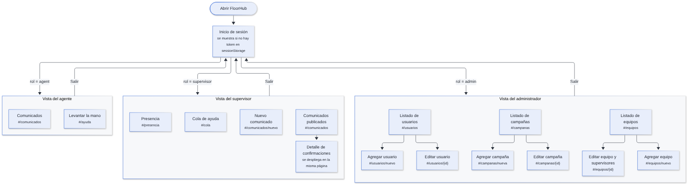
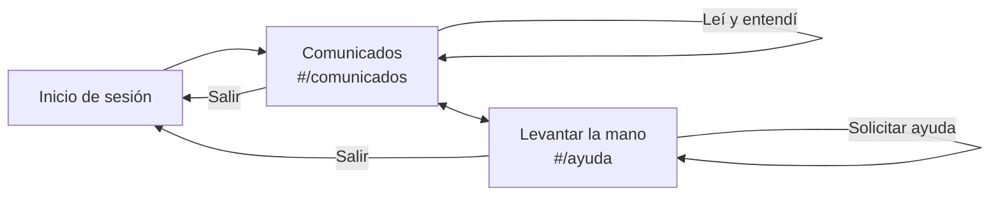
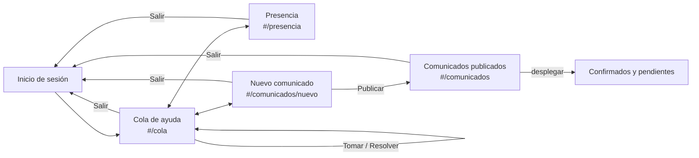
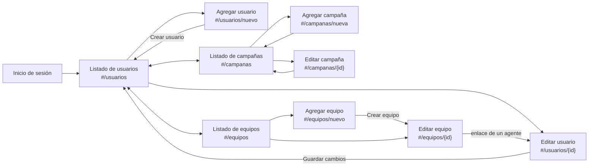

# Mapa de Navegación — FloorHub

## 1. Diagrama general

Después de iniciar sesión, cada rol entra a una vista distinta con su propio menú lateral. No hay páginas compartidas entre roles, salvo el inicio de sesión.

## 2. Diagramas por sección (se dibujan en GitHub)

### 2.1. Agente

### 2.2. Supervisor

### 2.3. Administrador

Al crear un equipo, la aplicación abre directamente su página de edición para asignarle supervisores.

## 3. Inventario de rutas

| Rol | Ruta | Página | Llamadas a la API |
|---|---|---|---|
| Todos | (sin hash) | Inicio de sesión | `POST /auth/login`, `GET /auth/me` |
| Agente | `#/comunicados` | Comunicados | `GET /announcements`, `POST /announcements/{id}/ack` |
| Agente | `#/ayuda` | Levantar la mano | `GET /help-requests`, `POST /help-requests` |
| Supervisor | `#/cola` | Cola de ayuda | `GET /help-requests`, `POST /help-requests/{id}/claim`, `POST /help-requests/{id}/resolve` |
| Supervisor | `#/presencia` | Presencia | `GET /presence` |
| Supervisor | `#/comunicados/nuevo` | Nuevo comunicado | `GET /directory`, `POST /announcements` |
| Supervisor | `#/comunicados` | Comunicados publicados | `GET /announcements`, `GET /announcements/{id}/status` |
| Admin | `#/usuarios` | Listado de usuarios | `GET /admin/users`, `GET /admin/teams`, `GET /admin/campaigns` |
| Admin | `#/usuarios/nuevo` | Agregar usuario | `POST /admin/users` |
| Admin | `#/usuarios/{id}` | Editar usuario | `PATCH /admin/users/{id}` |
| Admin | `#/campanas`, `#/campanas/nueva`, `#/campanas/{id}` | Campañas | `POST /admin/campaigns`, `PATCH /admin/campaigns/{id}` |
| Admin | `#/equipos`, `#/equipos/nuevo` | Equipos | `POST /admin/teams` |
| Admin | `#/equipos/{id}` | Editar equipo | `PATCH /admin/teams/{id}`, `PUT /admin/teams/{id}/supervisors` |

La vista del supervisor carga la cola, la presencia y el directorio a la vez al conectar, para que los contadores del menú estén al día en cualquier página.

## 4. Eventos en vivo por página

| Página | Eventos que la actualizan sin recargar |
|---|---|
| Agente · Comunicados | `announcement:new`, `announcement:reminder` |
| Agente · Levantar la mano | `help:created`, `help:claimed`, `help:resolved` |
| Supervisor · Cola de ayuda | `help:created`, `help:claimed`, `help:resolved` |
| Supervisor · Presencia | `presence:changed` |
| Supervisor · Comunicados publicados | `announcement:published`, `announcement:acknowledged` |

## 5. Observaciones de navegación

- **Enrutado por hash.** Cambiar de página no recarga el documento ni requiere reglas en Nginx, y cada ventana conserva su página.
- **Rutas desconocidas.** Si la ruta no existe para el rol, se abre la página por defecto: `#/comunicados` (agente), `#/cola` (supervisor) o `#/usuarios` (administrador).
- **Una página por función.** Las tareas frecuentes quedan a un clic en el menú lateral, agrupado en secciones («Piso» y «Comunicados» para el supervisor; «Usuarios», «Campañas» y «Equipos» para el administrador).
- **Sesión vencida.** Cualquier respuesta 401 devuelve al inicio de sesión desde cualquier página.
- **Pantallas pequeñas.** Por debajo de 860 px, el menú lateral se vuelve horizontal.
