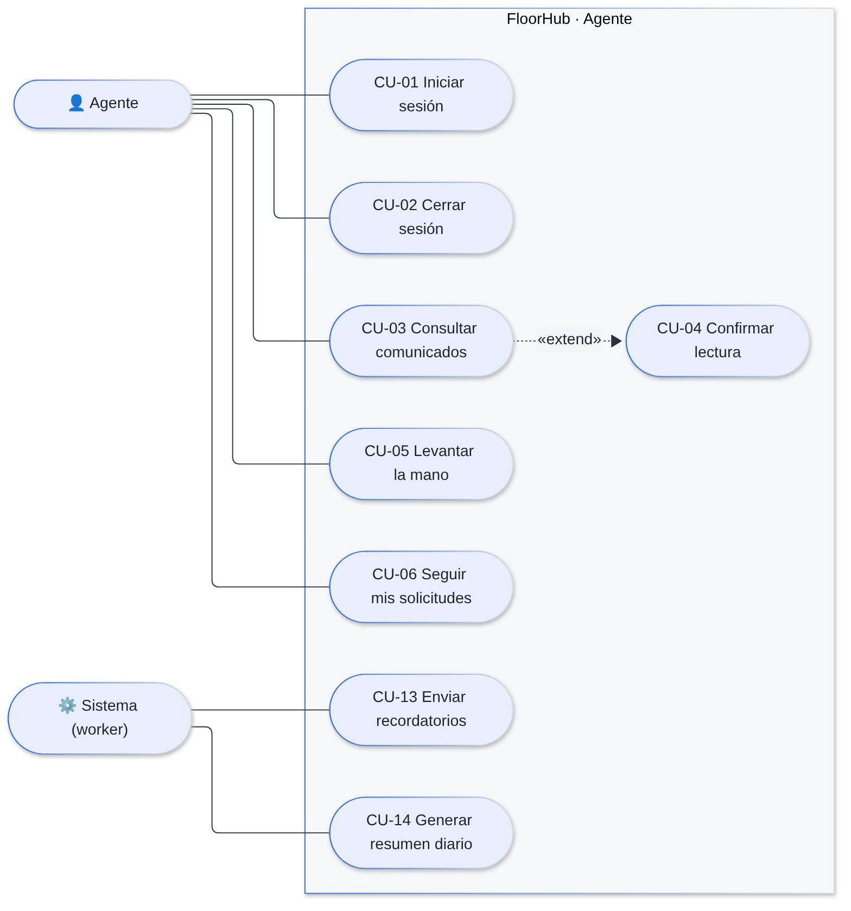
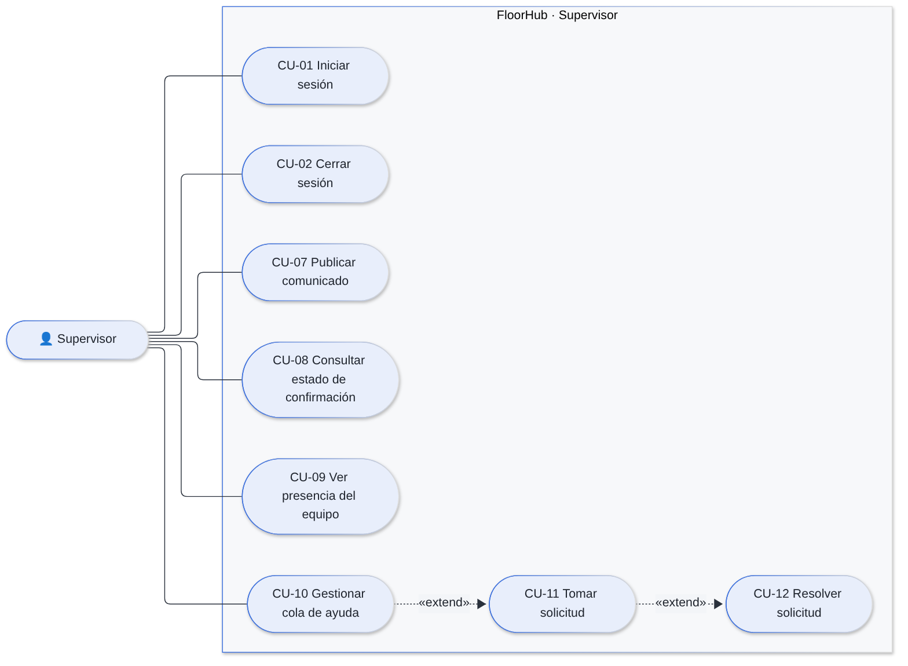
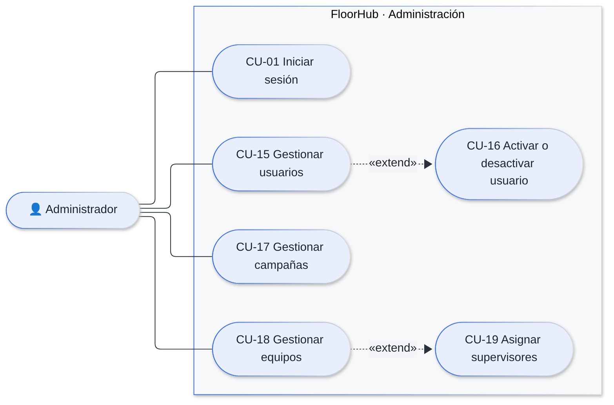

# Casos de Uso — FloorHub

## 1. Actores

| Actor | Tipo | Descripción |
|---|---|---|
| Agente | Primario | Atiende clientes en el piso. Lee y confirma comunicados y pide ayuda. Pertenece a un solo equipo. |
| Supervisor | Primario | Coordina uno o varios equipos. Publica comunicados, ve la presencia y atiende la cola de ayuda. |
| Administrador | Primario | Gestiona usuarios, campañas, equipos y la asignación de supervisores. No participa en la operación diaria. |
| Sistema (worker) | Secundario, temporizado | Envía recordatorios, reconcilia colas, expira la presencia y genera el resumen diario. |

## 2. Diagramas

### 2.1. Agente y sistema

### 2.2. Supervisor

### 2.3. Administrador

## 3. Catálogo de casos de uso

| Código | Caso de uso | Actor | Prioridad |
|---|---|---|---|
| CU-01 | Iniciar sesión | Todos | Alta |
| CU-02 | Cerrar sesión | Todos | Alta |
| CU-03 | Consultar comunicados | Agente | Alta |
| CU-04 | Confirmar lectura | Agente | Alta |
| CU-05 | Levantar la mano | Agente | Alta |
| CU-06 | Seguir mis solicitudes | Agente | Media |
| CU-07 | Publicar comunicado | Supervisor | Alta |
| CU-08 | Consultar estado de confirmación | Supervisor | Alta |
| CU-09 | Ver presencia del equipo | Supervisor | Media |
| CU-10 | Gestionar cola de ayuda | Supervisor | Alta |
| CU-11 | Tomar solicitud | Supervisor | Alta |
| CU-12 | Resolver solicitud | Supervisor | Alta |
| CU-13 | Enviar recordatorios | Sistema | Alta |
| CU-14 | Generar resumen diario | Sistema | Baja |
| CU-15 | Gestionar usuarios | Administrador | Alta |
| CU-16 | Activar o desactivar usuario | Administrador | Alta |
| CU-17 | Gestionar campañas | Administrador | Alta |
| CU-18 | Gestionar equipos | Administrador | Alta |
| CU-19 | Asignar supervisores | Administrador | Alta |

## 4. Especificación de los casos principales

### CU-01 Iniciar sesión

| Campo | Descripción |
|---|---|
| Actor | Agente, supervisor o administrador |
| Precondición | El usuario existe y está activo |
| Postcondición | La ventana guarda un token válido por 8 horas y muestra la vista del rol |

**Flujo principal**

1. El usuario escribe su correo y su contraseña y pulsa entrar.
2. El sistema verifica el límite de intentos (10 por minuto por IP y correo).
3. El sistema compara la contraseña con el hash bcrypt.
4. El sistema emite un JWT y lo guarda en `sessionStorage`.
5. El sistema carga el alcance del usuario (rol, equipos y campañas) y muestra su vista.

**Flujos alternativos**

- **3a.** Correo inexistente, contraseña incorrecta o usuario inactivo: muestra «Correo o contraseña incorrectos» (mismo mensaje en los tres casos).
- **2a.** Se superó el límite: muestra «Demasiados intentos. Espera un minuto.»

### CU-04 Confirmar lectura

| Campo | Descripción |
|---|---|
| Actor | Agente |
| Precondición | El agente es destinatario del comunicado |
| Postcondición | Existe un registro inmutable con la fecha y hora de confirmación |

**Flujo principal**

1. El agente abre «Comunicados» y lee un comunicado.
2. Pulsa «Leí y entendí».
3. El sistema inserta la confirmación.
4. Si todos los destinatarios confirmaron, el sistema cancela los recordatorios pendientes.
5. El supervisor ve subir el porcentaje en vivo.

**Flujos alternativos**

- **3a.** Ya había confirmado: el sistema conserva la fecha original y no duplica el registro.
- **3b.** No es destinatario: el sistema responde «Comunicado no encontrado».

### CU-05 Levantar la mano

| Campo | Descripción |
|---|---|
| Actor | Agente |
| Precondición | El agente no tiene otra solicitud pendiente o en atención |
| Postcondición | La solicitud aparece en la cola de los supervisores de su equipo |

**Flujo principal**

1. El agente abre «Levantar la mano».
2. Elige el tipo: «Cliente difícil», «Aprobación» o «Duda de proceso».
3. Escribe un resumen de hasta 500 caracteres y pulsa «Solicitar ayuda».
4. El sistema asigna la prioridad según el tipo (3, 2 o 1) y guarda la solicitud como «Pendiente».
5. Los supervisores del equipo la ven aparecer en su cola, y el agente ve su estado y el tiempo de espera.

**Flujos alternativos**

- **4a.** Ya tiene una solicitud activa: «Ya tienes una solicitud activa».
- **4b.** Superó 10 solicitudes en un minuto: «Demasiados intentos. Espera un minuto.»

### CU-07 Publicar comunicado

| Campo | Descripción |
|---|---|
| Actor | Supervisor |
| Precondición | Supervisa al menos un equipo con agentes activos |
| Postcondición | El comunicado, sus destinos y su audiencia quedan guardados; los agentes conectados lo reciben al instante |

**Flujo principal**

1. El supervisor abre «Nuevo comunicado».
2. Escribe el título (hasta 200 caracteres) y el cuerpo (hasta 5 000).
3. Elige la prioridad. Si es «Crítico», indica cada cuántos minutos recordar (1 a 240).
4. Busca y elige destinos: campañas, equipos o agentes.
5. Pulsa «Publicar».
6. El sistema verifica el alcance, guarda todo en una transacción y entrega el comunicado.
7. Si es crítico, programa la primera ronda de recordatorios.

**Flujos alternativos**

- **4a.** No eligió destinos: «Elige al menos un destino».
- **6a.** Un destino está fuera de sus equipos: «Solo puedes publicar a tus equipos, tus campañas o tus agentes».
- **6b.** Los destinos no alcanzan a ningún agente activo: «El comunicado no alcanza a ningún agente activo».

### CU-11 Tomar solicitud

| Campo | Descripción |
|---|---|
| Actor | Supervisor |
| Precondición | La solicitud está «Pendiente» y pertenece a uno de sus equipos |
| Postcondición | La solicitud queda «En atención» con un único responsable |

**Flujo principal**

1. El supervisor ve la cola ordenada por prioridad y antigüedad.
2. Pulsa «Tomar» en una solicitud.
3. El sistema cambia el estado de forma atómica y registra la hora.
4. El agente ve «En atención» con el nombre del supervisor.

**Flujo alternativo**

- **3a.** Otro supervisor la tomó un instante antes: «Otro supervisor ya tomó esta solicitud».

### CU-13 Enviar recordatorios

| Campo | Descripción |
|---|---|
| Actor | Sistema (worker) |
| Disparador | Vence el intervalo de un comunicado crítico |
| Postcondición | Los agentes sin confirmar reciben un aviso y se programa la siguiente ronda |

**Flujo principal**

1. El worker recibe el trabajo de la ronda N.
2. Bloquea el comunicado y verifica que la ronda N no se haya procesado.
3. Busca a los destinatarios sin confirmación.
4. Les envía «Recordatorio: confirma «…»» y suma uno a su contador.
5. Si quedan rondas (máximo 5), programa la siguiente.

**Flujos alternativos**

- **2a.** La ronda ya se procesó (trabajo duplicado): termina sin notificar.
- **3a.** Todos confirmaron o el comunicado venció: cancela los recordatorios.
- **Excepción.** Redis se reinició y perdió el trabajo: el reconciliador lo reencola en menos de 60 segundos.

### CU-15 Gestionar usuarios

| Campo | Descripción |
|---|---|
| Actor | Administrador |
| Postcondición | El usuario queda creado o actualizado y, si cambió su alcance, su sesión en vivo se reconecta con los permisos nuevos |

**Flujo principal**

1. El administrador abre «Listado de usuarios» y puede buscar por nombre, correo o equipo, o filtrar por rol.
2. Pulsa «Agregar usuario» o «Editar» en un usuario.
3. Completa nombre, correo, contraseña (al crear), rol y, si es agente, equipo.
4. Pulsa «Crear usuario» o «Guardar cambios».

**Flujos alternativos**

- **4a.** El correo ya existe: «Ya existe un registro con esos datos».
- **4b.** Un agente sin equipo, o un supervisor con equipo: «Los datos no cumplen las reglas del sistema».
- **4c.** En edición, la contraseña vacía no se cambia.

## 5. Relación con los requisitos

| Caso de uso | Requisitos funcionales |
|---|---|
| CU-01 Iniciar sesión | RF-01, RF-03 |
| CU-02 Cerrar sesión | RF-02 |
| CU-03 Consultar comunicados | RF-13 |
| CU-04 Confirmar lectura | RF-14 |
| CU-05 Levantar la mano | RF-17, RF-18 |
| CU-06 Seguir mis solicitudes | RF-22, RF-23 |
| CU-07 Publicar comunicado | RF-11, RF-12, RF-25 |
| CU-08 Consultar estado de confirmación | RF-15 |
| CU-09 Ver presencia | RF-24 |
| CU-10 Gestionar cola de ayuda | RF-19, RF-23 |
| CU-11 Tomar solicitud | RF-20 |
| CU-12 Resolver solicitud | RF-21 |
| CU-13 Enviar recordatorios | RF-16 |
| CU-14 Generar resumen diario | — (función de soporte) |
| CU-15 Gestionar usuarios | RF-04, RF-05, RF-07, RF-25 |
| CU-16 Activar o desactivar usuario | RF-06 |
| CU-17 Gestionar campañas | RF-08 |
| CU-18 Gestionar equipos | RF-09, RF-25 |
| CU-19 Asignar supervisores | RF-10 |

La matriz completa, con requisitos, casos de uso y clases, está en la hoja «Trazabilidad» de [Matriz_de_requerimientos_FloorHub.xlsx](requerimientos/Matriz_de_requerimientos_FloorHub.xlsx).
