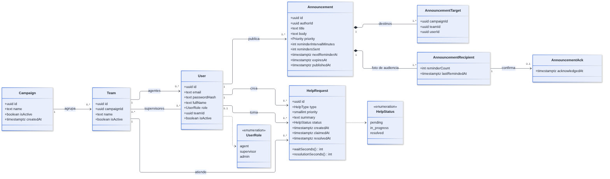
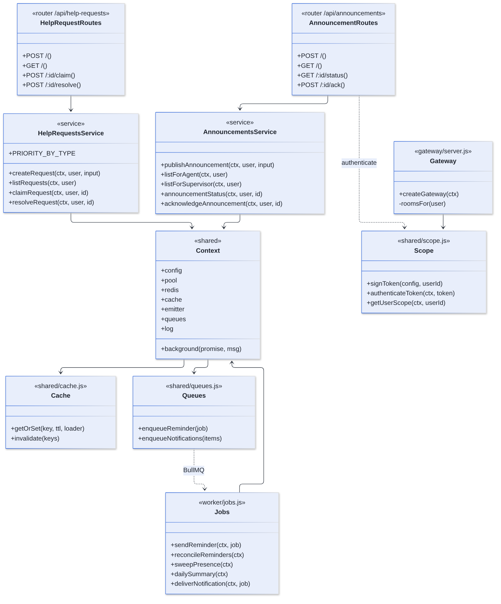

# Diagrama de Clases — FloorHub

FloorHub está escrito en JavaScript con **módulos y funciones**, no con clases. Por eso hay dos diagramas:

1. **Modelo de dominio:** las entidades del negocio, que corresponden a las tablas de PostgreSQL.
2. **Arquitectura por capas:** los módulos del código, representados como clases con sus funciones públicas.

## 1. Modelo de dominio

| Clase | Responsabilidad | Tabla |
|---|---|---|
| `Campaign` | Agrupar equipos de un mismo cliente | `campaigns` |
| `Team` | Agrupar agentes bajo uno o varios supervisores | `teams`, `team_supervisors` |
| `User` | Identidad, rol y pertenencia | `users` |
| `Announcement` | Contenido inmutable y estado de recordatorios | `announcements` |
| `AnnouncementTarget` | Destino elegido (campaña, equipo o agente) | `announcement_targets` |
| `AnnouncementRecipient` | Agente alcanzado y sus recordatorios | `announcement_recipients` |
| `AnnouncementAck` | Prueba de lectura | `announcement_acks` |
| `HelpRequest` | Solicitud con su ciclo de estados y sus tiempos | `help_requests` |

**Composición:** los destinos y los destinatarios no existen sin su comunicado (rombo relleno). **Métodos derivados:** `waitSeconds()` y `resolutionSeconds()` se calculan en la consulta SQL (`SELECT_REQUEST`), no se guardan.

## 2. Arquitectura por capas

| Capa | Módulos | Depende de |
|---|---|---|
| Presentación HTTP | `routes/*.js`, `middleware/*.js` | Servicios, `validation.js`, `errors.js` |
| Tiempo real | `gateway/server.js` | `shared/scope.js`, `shared/realtime.js` |
| Negocio | `services/*.js`: `announcements`, `helpRequests`, `auth`, `campaigns`, `teams`, `users`, `directory`, `presence` y `common` | `Context` |
| Trabajos | `worker/jobs.js` | `Context` |
| Infraestructura compartida | `shared/context.js`, `db.js`, `cache.js`, `queues.js`, `realtime.js`, `scope.js`, `config.js` | PostgreSQL, Redis |

### 2.1. Funciones, rutas y tablas

| Función | Ruta o disparador | Tablas que lee | Tablas que escribe |
|---|---|---|---|
| `login` (en `services/auth.js`) | `POST /api/auth/login` | `users` | — |
| `getUserScope` | Toda petición autenticada | `users`, `team_supervisors`, `teams` | — |
| `publishAnnouncement` | `POST /api/announcements` | `users`, `teams` | `announcements`, `announcement_targets`, `announcement_recipients` |
| `listForAgent` | `GET /api/announcements` (agente) | `announcement_recipients`, `announcements`, `announcement_acks`, `users` | — |
| `listForSupervisor` | `GET /api/announcements` (supervisor) | `announcements`, `announcement_recipients`, `announcement_acks`, `users` | — |
| `announcementStatus` | `GET /api/announcements/{id}/status` | `announcements`, `announcement_recipients`, `announcement_acks`, `users`, `teams` | — |
| `acknowledgeAnnouncement` | `POST /api/announcements/{id}/ack` | `announcement_recipients` | `announcement_acks`, `announcements.next_reminder_at` |
| `createRequest` | `POST /api/help-requests` | — | `help_requests` |
| `listRequests` | `GET /api/help-requests` | `help_requests`, `users` | — |
| `claimRequest` | `POST /api/help-requests/{id}/claim` | `help_requests` | `help_requests` |
| `replyToRequest` | `POST /api/help-requests/{id}/replies` | `help_requests` | `help_request_replies` |
| `resolveRequest` | `POST /api/help-requests/{id}/resolve` | `help_requests` | `help_requests` |
| `sendReminder` | Cola `reminders` | `announcements`, `announcement_recipients`, `announcement_acks` | `announcements`, `announcement_recipients` |
| `reconcileReminders` | Cada 60 s | `announcements` | — (reencola en Redis) |
| `sweepPresence` | Cada 15 s | `presence:team:*` (Redis) | `presence:team:*` (Redis) |
| `dailySummary` | Todos los días a las 23:00 | `announcements`, `announcement_acks`, `help_requests` | — (escribe en el log) |

## 3. Observaciones de diseño

- **El `Context` es la inyección de dependencias.** Se construye una vez al arrancar (`shared/context.js`) y se pasa a cada función. En las pruebas se crea un contexto real apuntando a la base `floorhub_test`.
- **Nombres compartidos en un solo lugar.** Los nombres de eventos (`EVENTS`), de salas (`rooms`) y de claves de caché (`cacheKeys`) viven en `@floorhub/shared`. Así la API, el gateway y el worker no pueden escribir mal un nombre.
- **Los errores son objetos.** `AppError(status, code, message)` permite que un servicio lance un error de negocio sin conocer Express; `errorHandler` lo traduce a HTTP.
- **Un `UPDATE` dinámico seguro.** `buildUpdate` arma el `SET` solo con los campos enviados; los nombres de columna salen del código, nunca de la petición.
