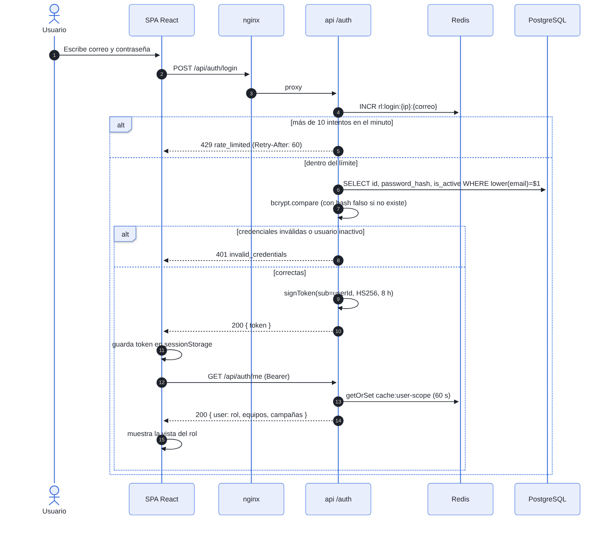
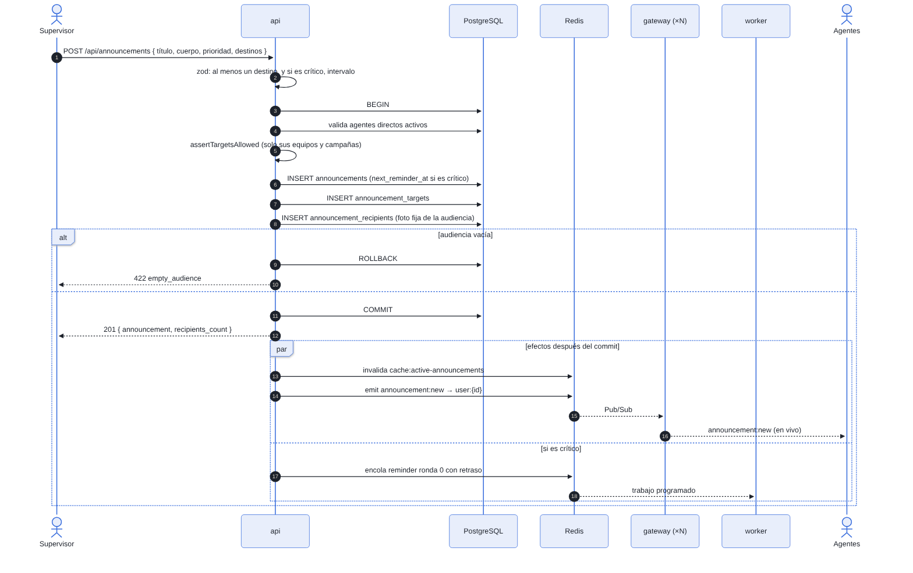
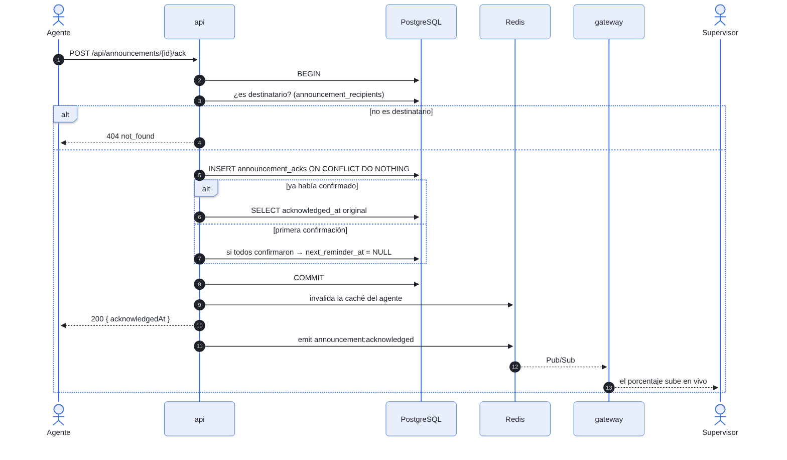
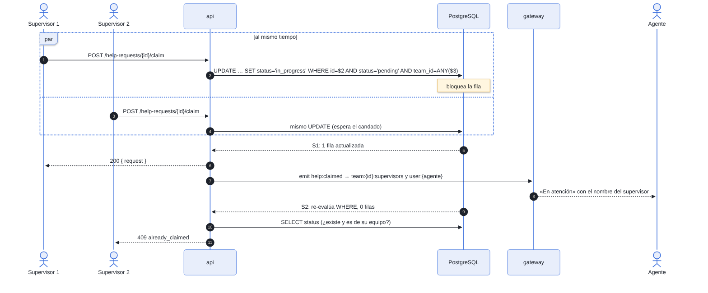
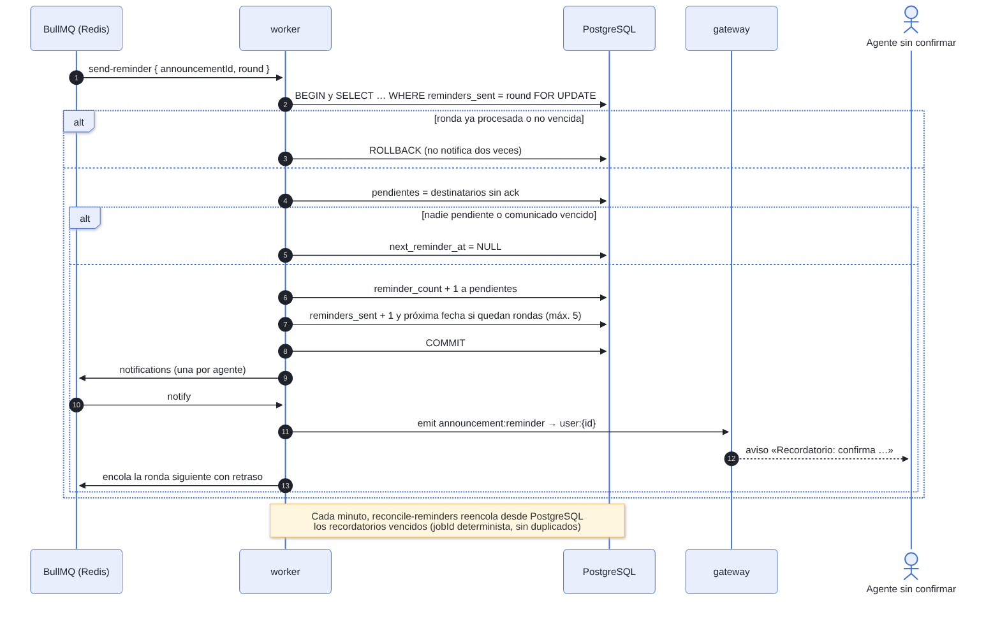
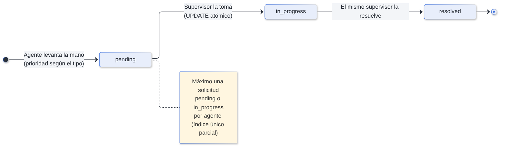

# Diagramas de Secuencia — FloorHub

Los cinco flujos más importantes del sistema. Las fuentes en Mermaid están en [`diagramas/fuentes`](diagramas/fuentes) y se pueden editar y volver a renderizar.

## 1. Iniciar sesión

**Puntos clave**

- El límite de intentos se cuenta por **IP y correo** en Redis, con una ventana de un minuto.
- Si el correo no existe, bcrypt compara contra un hash falso para que el tiempo de respuesta sea el mismo.
- El token solo lleva el id del usuario. El rol, los equipos y las campañas se cargan en `/auth/me` y en cada petición (con caché de 60 s).

## 2. Publicar un comunicado

**Puntos clave**

- Todo lo que se guarda (comunicado, destinos y audiencia) va en **una sola transacción**.
- Los efectos (invalidar caché, emitir eventos y encolar el recordatorio) ocurren **después del commit**. Si la transacción falla, nadie recibe nada.
- La API no tiene sockets: publica en Redis y cada réplica del gateway entrega a sus propios clientes.

## 3. Confirmar lectura

**Puntos clave**

- `ON CONFLICT DO NOTHING` hace que confirmar dos veces sea seguro: la segunda vez devuelve la fecha original.
- Cuando el último destinatario confirma, la misma transacción cancela los recordatorios (`next_reminder_at = NULL`).
- El evento llega al autor y a los supervisores de los equipos del agente, y el porcentaje sube en vivo.

## 4. Tomar una solicitud (concurrencia)

**Puntos clave**

- No se usa un candado en Redis: el bloqueo de fila de PostgreSQL basta.
- El segundo `UPDATE` espera, vuelve a evaluar `status = 'pending'` cuando el primero confirma y actualiza 0 filas.
- La API distingue «no existe o no es de tu equipo» (404) de «ya la tomó otro» (409).
- La prueba PH-01 lanza 10 peticiones simultáneas: exactamente 1 gana y 9 reciben 409.

## 5. Recordatorios y reconciliación

**Puntos clave**

- El `SELECT … FOR UPDATE` filtra por `reminders_sent = ronda`. Un trabajo repetido encuentra la ronda ya avanzada y termina sin notificar.
- Cada notificación es un trabajo propio en la cola `notifications`, con 3 reintentos.
- El reconciliador usa `jobId = reminder-{id}-{ronda}`: si el trabajo sigue en la cola, BullMQ ignora el duplicado; si Redis lo perdió, se vuelve a crear.

## 6. Ciclo de vida de una solicitud de ayuda

| Transición | Quién | Evento emitido | Destinatarios del evento |
|---|---|---|---|
| — → Pendiente | Agente | `help:created` | Supervisores del equipo y el agente |
| Pendiente → En atención | Supervisor del equipo | `help:claimed` | Supervisores del equipo y el agente |
| En atención → Resuelta | El mismo supervisor | `help:resolved` | Supervisores del equipo y el agente |
