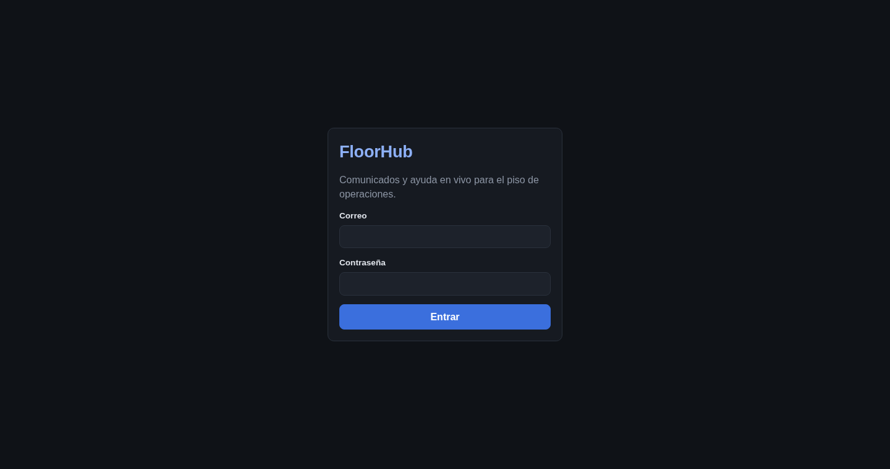
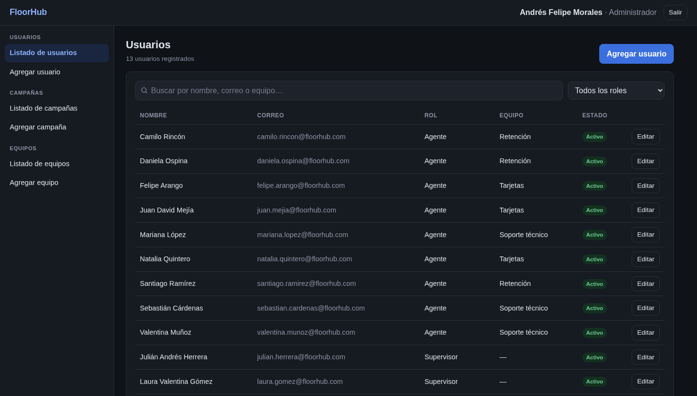
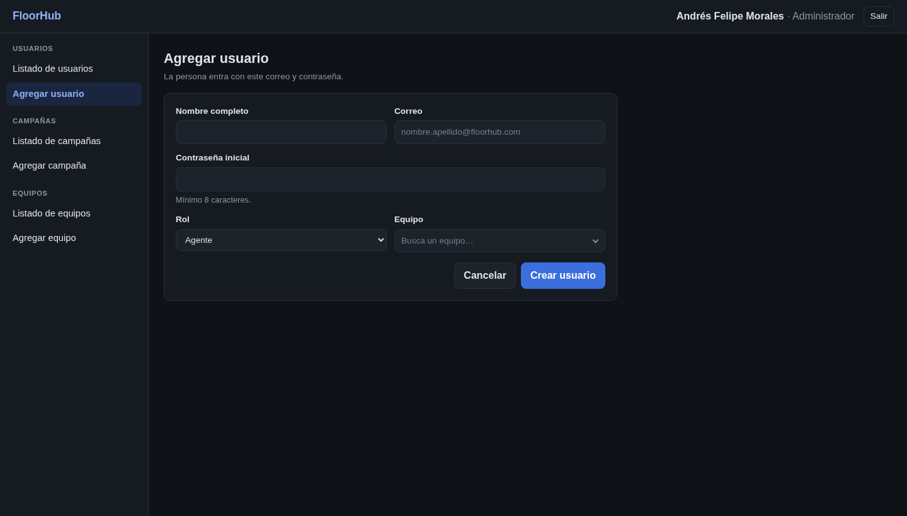
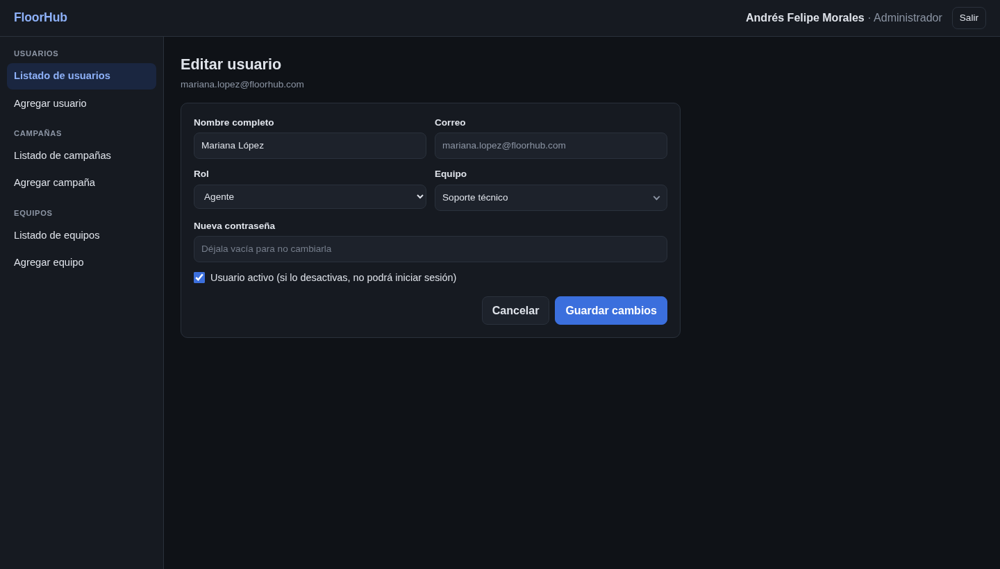
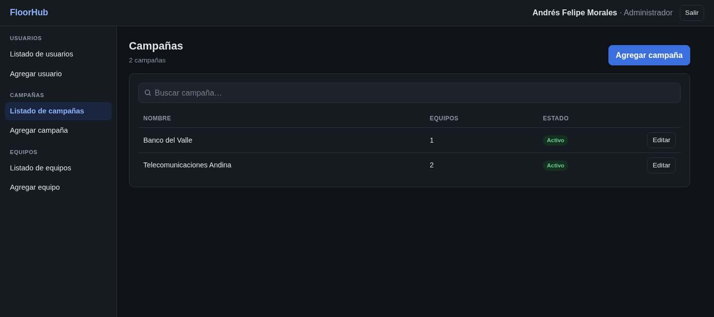
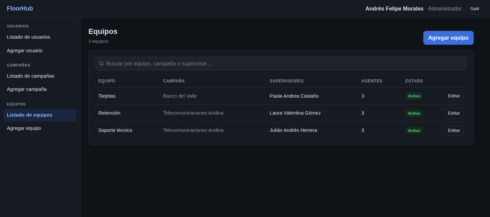
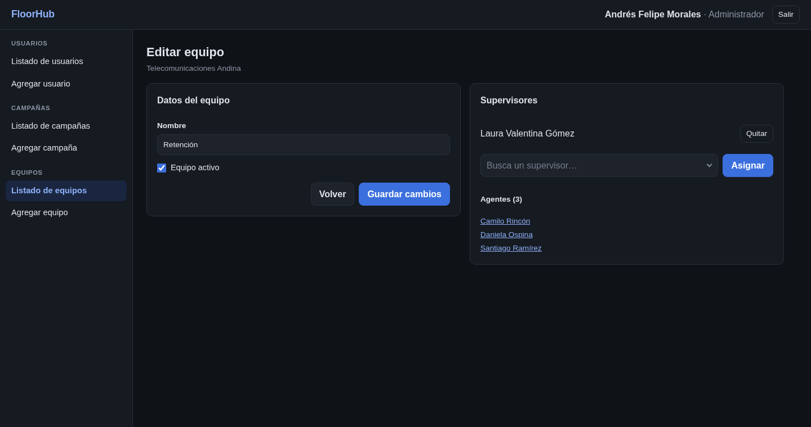

# Manual de Usuario — Administrador — FloorHub

*Comunicados y ayuda en vivo para el piso de operaciones*

Esta guía cubre solo el rol de **administrador**. Hay un manual por rol: [agente](13-manual-de-usuario-agente.md), [supervisor](13-manual-de-usuario-supervisor.md) y [administrador](13-manual-de-usuario-administrador.md).

La versión maquetada para imprimir está en [manual/manual-de-usuario-administrador.pdf](manual/manual-de-usuario-administrador.pdf).

## Tabla de contenido

1. [Antes de empezar](#1-antes-de-empezar)
2. [Acceso al sistema](#2-acceso-al-sistema)
3. [Recorrido por la interfaz](#3-recorrido-por-la-interfaz)
4. [Guía del administrador](#4-guía-del-administrador)
5. [Preguntas frecuentes y solución de problemas](#5-preguntas-frecuentes-y-solución-de-problemas)

---

## 1. Antes de empezar

### Qué necesitas

| Elemento | Requisito |
|---|---|
| Navegador | Google Chrome, Microsoft Edge, Mozilla Firefox o Safari en una versión actual |
| Conexión | Acceso a la red donde está publicada FloorHub; la conexión en vivo usa WebSocket |
| Pantalla | Computador, tableta o celular; se recomienda 1280 × 720 o más |
| Cuenta | Un usuario creado por el administrador (no hay registro abierto) |

### Tipos de usuario

| Rol | Quién es | Qué hace en FloorHub |
|---|---|---|
| Agente | Persona que atiende llamadas o chats de clientes | Lee y confirma comunicados y pide ayuda a su supervisor |
| Supervisor | Líder de uno o varios equipos | Publica comunicados, atiende la cola de ayuda y ve la presencia de su equipo |
| Administrador | Responsable de la plataforma | Crea y edita usuarios, campañas y equipos, y asigna supervisores |

Una **campaña** agrupa los equipos que atienden a un mismo cliente. Un agente pertenece a un solo equipo; un supervisor puede supervisar varios.

### Conceptos básicos

| Tipo de comunicado | Uso | Recordatorios |
|---|---|---|
| Informativo | Avisos generales: mantenimientos, horarios, noticias | No |
| Crítico | Cambios que el agente debe aplicar ya: precios, guiones, procesos | Cada N minutos a quien no ha confirmado, hasta 5 rondas |

| Tipo de solicitud de ayuda | Prioridad | Ejemplo |
|---|---|---|
| Cliente difícil | 3 · Alta | El cliente exige hablar con un superior |
| Aprobación | 2 · Media | Autorizar un descuento mayor al permitido |
| Duda de proceso | 1 · Baja | ¿Se puede ofrecer este plan a un cliente con mora? |

| Estado de una solicitud | Significado |
|---|---|
| Pendiente | En la cola, esperando a que un supervisor la tome |
| En atención | Un supervisor la tomó; se mide el tiempo de espera |
| Resuelta | El supervisor la cerró; se mide el tiempo de atención |

### Cuentas de prueba

En una instalación local, todas usan la contraseña `Demo-FloorHub-2026`.

| Rol | Nombre | Correo | Equipo |
|---|---|---|---|
| Administrador | Andrés Felipe Morales | `andres.morales@floorhub.com` | — |

## 2. Acceso al sistema

### 2.1. Iniciar sesión

1. Abre FloorHub en el navegador (en local, <http://localhost:8080>).
2. Escribe tu correo y tu contraseña.
3. Pulsa **Entrar**. El sistema abre las páginas de tu rol.

> Tras 10 intentos fallidos en un minuto, el acceso se bloquea temporalmente. La sesión dura un turno (8 horas); al vencer, el sistema vuelve a pedir tus datos.

Cada ventana o pestaña conserva su propia sesión, así que puedes abrir varias con usuarios distintos en el mismo navegador.

### 2.2. Cerrar sesión

Pulsa **Salir** en la esquina superior derecha. El token de la ventana se borra de inmediato.

## 3. Recorrido por la interfaz

- **Barra superior:** logo, indicador de conexión, tu nombre y rol, y el botón **Salir**.
- **Menú lateral:** una entrada por cada función de tu rol, con contadores (solicitudes en espera, comunicados por confirmar). En el celular pasa a ser una barra horizontal.
- **Indicador de conexión:** «● Disponible» significa que estás conectado y recibes los cambios al instante; «Reconectando…» indica que se perdió la conexión. Al recuperarse, la página se actualiza sola.
- **Avisos emergentes:** aparecen en la esquina inferior derecha (nuevo comunicado, recordatorio, solicitud tomada, errores).
- **Buscadores:** no distinguen tildes («munoz» encuentra «Muñoz»). En los selectores puedes usar ↑ ↓ para moverte, Enter para elegir y Esc para cerrar.

## 4. Guía del administrador

### 4.1. Usuarios

El **Listado de usuarios** muestra a todas las personas con su rol, equipo y estado. Usa el buscador (nombre, correo o equipo) y el filtro por rol.

**Agregar un usuario**

1. Entra a **Agregar usuario**.
2. Escribe el nombre completo, el correo y una contraseña inicial de al menos 8 caracteres.
3. Elige el rol. Si es **Agente**, busca y elige su equipo.
4. Pulsa **Crear usuario**.

> Solo los agentes pertenecen directamente a un equipo. Un supervisor se crea sin equipo y luego se asigna desde la página del equipo.

**Editar o desactivar un usuario:** pulsa **Editar**. Puedes cambiar el nombre, el rol, el equipo y la contraseña (déjala vacía para conservarla). Desmarca **Usuario activo** para impedirle iniciar sesión. Los usuarios no se borran, para conservar el historial.

### 4.2. Campañas

En **Listado de campañas** ves cada campaña con su número de equipos. Con **Agregar campaña** creas una; con **Editar** la renombras o la desactivas.

### 4.3. Equipos y supervisores

Con **Agregar equipo** eliges la campaña y escribes el nombre. Al crearlo se abre su página para asignar supervisores. En la edición puedes renombrarlo, desactivarlo, asignar o quitar supervisores y ver sus agentes.

> Un equipo sin supervisor queda marcado en ámbar: sus solicitudes de ayuda no tendrían quién las atienda.

## 5. Preguntas frecuentes y solución de problemas

| Situación | Qué hacer |
|---|---|
| «Correo o contraseña incorrectos» | Revisa mayúsculas y espacios. Si sigue, pide al administrador que restablezca tu contraseña o verifique que tu usuario esté activo. |
| No puedo entrar tras varios intentos | Superaste 10 intentos en un minuto. Espera un minuto. |
| Aparece «Reconectando…» | Se perdió la conexión en vivo. Revisa tu red; al reconectar, la página se actualiza sola. |
| Un agente no aparece en el equipo | El administrador debe editar el usuario y elegir el equipo correcto. |

Los términos del dominio están en el [glosario](15-glosario-tecnico.md).
