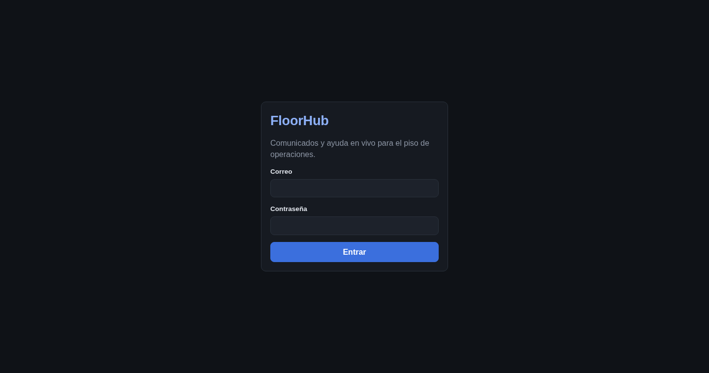
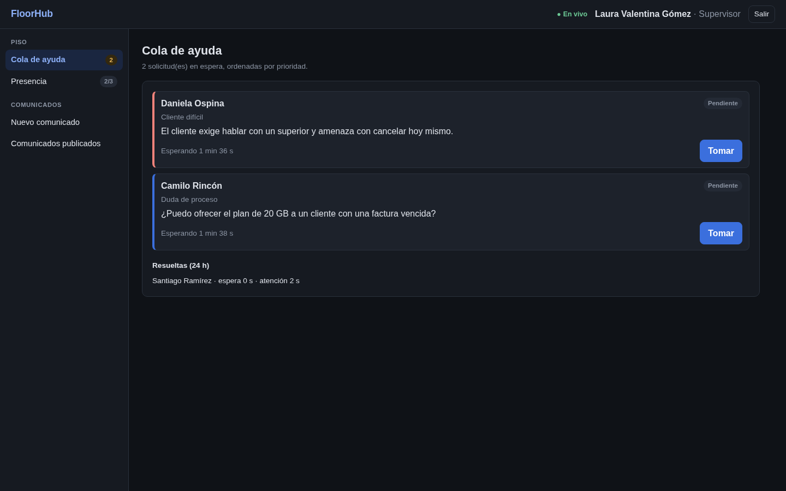
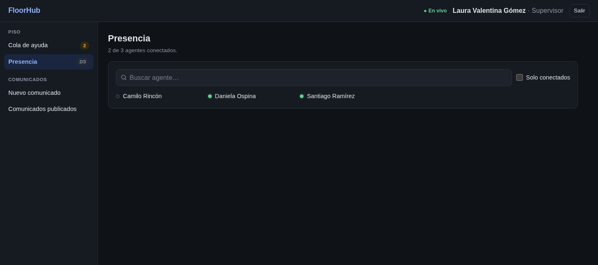
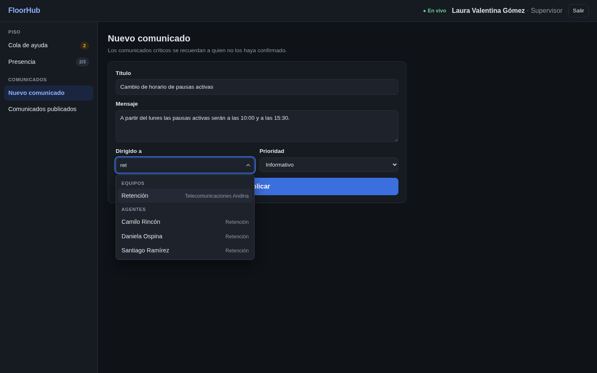
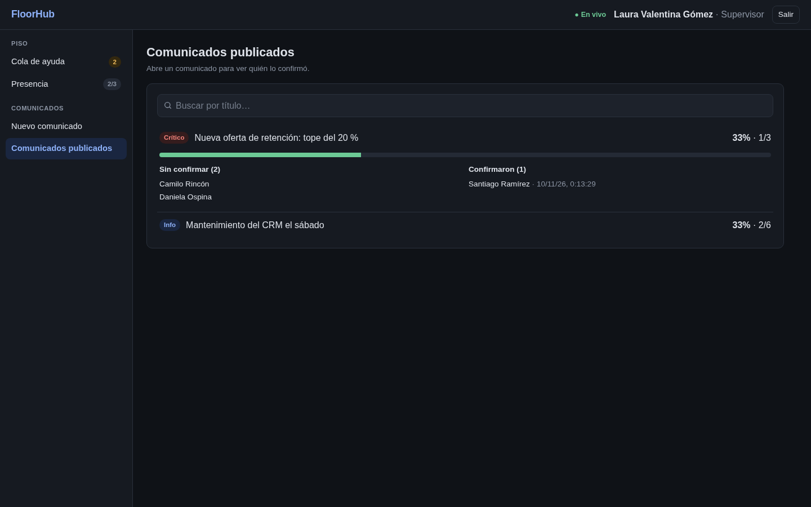

# Manual de Usuario — Supervisor — FloorHub

*Comunicados y ayuda en vivo para el piso de operaciones*

Esta guía cubre solo el rol de **supervisor**. Hay un manual por rol: [agente](13-manual-de-usuario-agente.md), [supervisor](13-manual-de-usuario-supervisor.md) y [administrador](13-manual-de-usuario-administrador.md).

La versión maquetada para imprimir está en [manual/manual-de-usuario-supervisor.pdf](manual/manual-de-usuario-supervisor.pdf).

## Tabla de contenido

1. [Antes de empezar](#1-antes-de-empezar)
2. [Acceso al sistema](#2-acceso-al-sistema)
3. [Recorrido por la interfaz](#3-recorrido-por-la-interfaz)
4. [Guía del supervisor](#4-guía-del-supervisor)
5. [Preguntas frecuentes y solución de problemas](#5-preguntas-frecuentes-y-solución-de-problemas)

---

## 1. Antes de empezar

### Qué necesitas

| Elemento | Requisito |
|---|---|
| Navegador | Google Chrome, Microsoft Edge, Mozilla Firefox o Safari en una versión actual |
| Conexión | Acceso a la red donde está publicada FloorHub; la conexión en vivo usa WebSocket |
| Pantalla | Computador, tableta o celular; se recomienda 1280 × 720 o más |
| Cuenta | Un usuario creado por el administrador (no hay registro abierto) |

### Tipos de usuario

| Rol | Quién es | Qué hace en FloorHub |
|---|---|---|
| Agente | Persona que atiende llamadas o chats de clientes | Lee y confirma comunicados y pide ayuda a su supervisor |
| Supervisor | Líder de uno o varios equipos | Publica comunicados, atiende la cola de ayuda y ve la presencia de su equipo |
| Administrador | Responsable de la plataforma | Crea y edita usuarios, campañas y equipos, y asigna supervisores |

Una **campaña** agrupa los equipos que atienden a un mismo cliente. Un agente pertenece a un solo equipo; un supervisor puede supervisar varios.

### Conceptos básicos

| Tipo de comunicado | Uso | Recordatorios |
|---|---|---|
| Informativo | Avisos generales: mantenimientos, horarios, noticias | No |
| Crítico | Cambios que el agente debe aplicar ya: precios, guiones, procesos | Cada N minutos a quien no ha confirmado, hasta 5 rondas |

| Tipo de solicitud de ayuda | Prioridad | Ejemplo |
|---|---|---|
| Cliente difícil | 3 · Alta | El cliente exige hablar con un superior |
| Aprobación | 2 · Media | Autorizar un descuento mayor al permitido |
| Duda de proceso | 1 · Baja | ¿Se puede ofrecer este plan a un cliente con mora? |

| Estado de una solicitud | Significado |
|---|---|
| Pendiente | En la cola, esperando a que un supervisor la tome |
| En atención | Un supervisor la tomó; se mide el tiempo de espera |
| Resuelta | El supervisor la cerró; se mide el tiempo de atención |

### Cuentas de prueba

En una instalación local, todas usan la contraseña `Demo-FloorHub-2026`.

| Rol | Nombre | Correo | Equipo |
|---|---|---|---|
| Supervisor | Laura Valentina Gómez | `laura.gomez@floorhub.com` | Retención |
| Supervisor | Julián Andrés Herrera | `julian.herrera@floorhub.com` | Soporte técnico |
| Supervisor | Paola Andrea Castaño | `paola.castano@floorhub.com` | Tarjetas |

## 2. Acceso al sistema

### 2.1. Iniciar sesión

1. Abre FloorHub en el navegador (en local, <http://localhost:8080>).
2. Escribe tu correo y tu contraseña.
3. Pulsa **Entrar**. El sistema abre las páginas de tu rol.

> Tras 10 intentos fallidos en un minuto, el acceso se bloquea temporalmente. La sesión dura un turno (8 horas); al vencer, el sistema vuelve a pedir tus datos.

Cada ventana o pestaña conserva su propia sesión, así que puedes abrir varias con usuarios distintos en el mismo navegador.

### 2.2. Cerrar sesión

Pulsa **Salir** en la esquina superior derecha. El token de la ventana se borra de inmediato.

## 3. Recorrido por la interfaz

- **Barra superior:** logo, indicador de conexión, tu nombre y rol, y el botón **Salir**.
- **Menú lateral:** una entrada por cada función de tu rol, con contadores (solicitudes en espera, comunicados por confirmar). En el celular pasa a ser una barra horizontal.
- **Indicador de conexión:** «● Disponible» significa que estás conectado y recibes los cambios al instante; «Reconectando…» indica que se perdió la conexión. Al recuperarse, la página se actualiza sola.
- **Avisos emergentes:** aparecen en la esquina inferior derecha (nuevo comunicado, recordatorio, solicitud tomada, errores).
- **Buscadores:** no distinguen tildes («munoz» encuentra «Muñoz»). En los selectores puedes usar ↑ ↓ para moverte, Enter para elegir y Esc para cerrar.

## 4. Guía del supervisor

### 4.1. Atender la cola de ayuda

La **Cola de ayuda** muestra las solicitudes de tus equipos, ordenadas por prioridad y luego por antigüedad. El borde indica la prioridad: rojo alta, ámbar media y azul baja.

1. Pulsa **Tomar** en la solicitud que vas a atender. El agente ve tu nombre al instante.
2. Lee la consulta del agente, que aparece destacada en la tarjeta.
3. Escribe en **Mensaje para el agente** y pulsa **Enviar mensaje**. El agente lo ve al instante y puede contestarte; la conversación sigue abierta hasta que resuelvas.
4. Pulsa **Resolver**. Quedan registrados los tiempos de espera y de atención.

> Si otro supervisor tomó la solicitud un instante antes, verás un aviso. Cada solicitud tiene un único responsable, y solo ese supervisor puede conversar con el agente mientras está en atención.

### 4.2. Ver la presencia

En **Presencia** ves qué agentes de tus equipos están conectados (punto verde). Puedes buscar por nombre y marcar **Solo conectados**.

### 4.3. Publicar un comunicado

1. Entra a **Nuevo comunicado**.
2. Escribe el título y el mensaje.
3. En **Dirigido a**, busca la campaña, el equipo o el agente y elígelo.
4. Elige la prioridad. Si es **Crítico**, indica cada cuántos minutos recordar (de 1 a 240).
5. Pulsa **Publicar**.

> Solo puedes publicar a tus equipos, a agentes de esos equipos o a campañas donde supervises al menos un equipo. Un comunicado publicado no se puede editar: para corregirlo, publica uno nuevo.

### 4.4. Seguir la confirmación

En **Comunicados publicados** cada fila muestra el porcentaje de confirmación. Pulsa un comunicado para ver quién confirmó (con la hora) y quién falta (con los recordatorios recibidos). Se actualiza en vivo.

## 5. Preguntas frecuentes y solución de problemas

| Situación | Qué hacer |
|---|---|
| «Correo o contraseña incorrectos» | Revisa mayúsculas y espacios. Si sigue, pide al administrador que restablezca tu contraseña o verifique que tu usuario esté activo. |
| No puedo entrar tras varios intentos | Superaste 10 intentos en un minuto. Espera un minuto. |
| Aparece «Reconectando…» | Se perdió la conexión en vivo. Revisa tu red; al reconectar, la página se actualiza sola. |
| Aviso al pulsar **Tomar** | Otro supervisor la tomó un instante antes. Sigue con la siguiente de la cola. |
| No encuentro un equipo al publicar | Solo aparecen tus equipos. Pide al administrador que te asigne como supervisor. |
| Quiero corregir un comunicado | Los comunicados publicados no se editan. Publica uno nuevo. |

Los términos del dominio están en el [glosario](15-glosario-tecnico.md).
