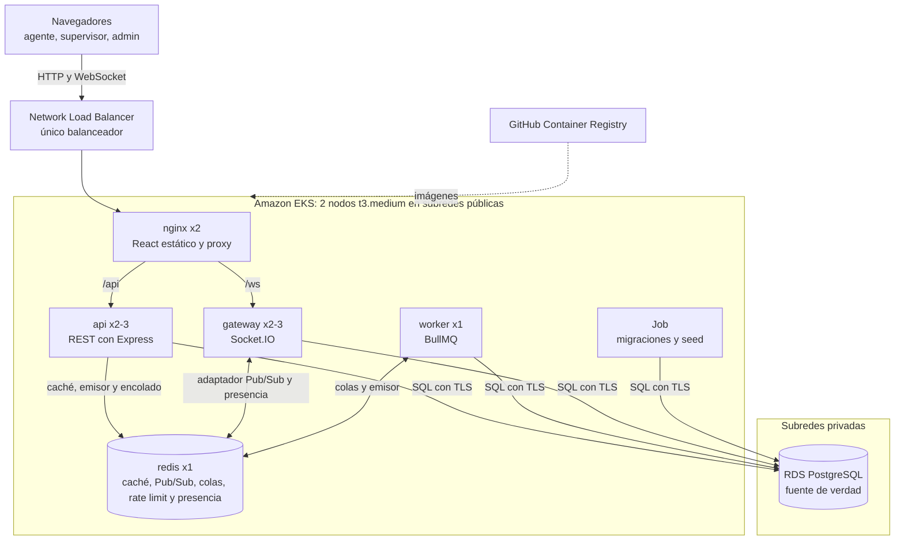
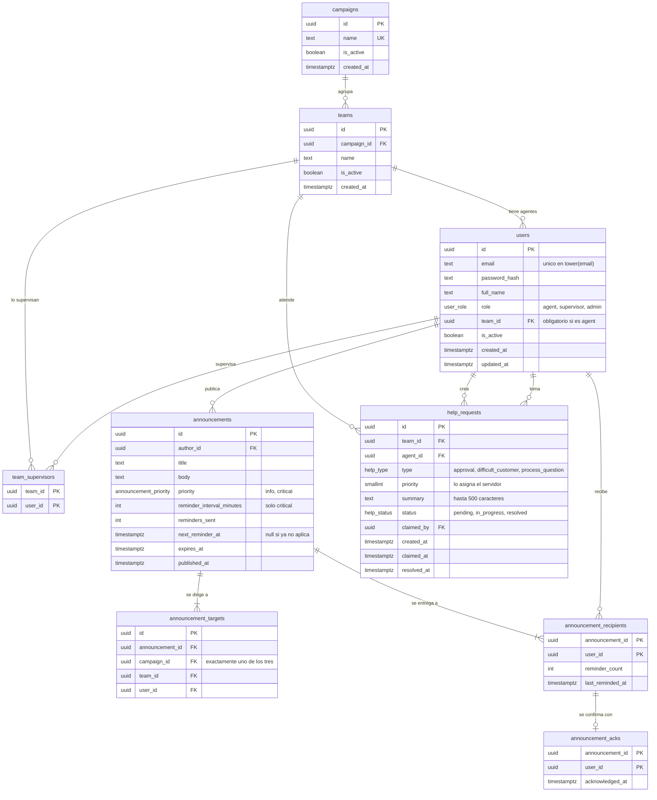

# FloorHub: diseño (Fase 1)

Estado: **implementado**. Precios revisados el 2026-11-05, región `us-east-1`, sin impuestos.

## 1. Arquitectura



**Cómo viaja un evento.** La API guarda en PostgreSQL y, después del commit, publica en Redis con `@socket.io/redis-emitter`. Cada réplica del gateway recibe el evento y lo entrega a sus clientes conectados, así que la API no necesita sockets propios.

### Decisiones de arquitectura

| Decisión | Por qué |
|---|---|
| Socket.IO solo con transporte `websocket`, en la ruta `/ws` | El *long-polling* exige sesiones pegajosas (*sticky sessions*) entre réplicas. Un WebSocket es una sola conexión TCP, de modo que no las necesita. |
| Al reconectar, el cliente vuelve a pedir el estado por REST | Redis Pub/Sub no guarda mensajes: lo emitido durante un corte se pierde. PostgreSQL permite recuperar el estado sin montar un *outbox*. |
| Monorepo con npm workspaces | `api`, `gateway` y `worker` comparten conexión a la base, logger y nombres de eventos, y cada uno sigue teniendo su propia imagen. |
| Token en `sessionStorage` | Cada ventana mantiene su propia sesión, y eso permite la demo con varios usuarios en un mismo navegador. Con cookies o `localStorage` las sesiones se pisarían. El costo es mayor exposición ante XSS, que se mitiga con React (escapa el contenido) y una cabecera CSP en Nginx. |
| JWT con duración de un turno (8 h), sin refresh tokens | Simplifica el MVP. Un usuario desactivado se bloquea al validar su estado, guardado en la caché de permisos que se invalida al cambiar. |

### Una sola instancia de Redis, cinco usos

| Uso | Claves o mecanismo | Si Redis se reinicia |
|---|---|---|
| Caché | `cache:*` con TTL | Se vuelve a llenar desde PostgreSQL |
| Pub/Sub | Canales del adaptador de Socket.IO | Los clientes reconectan y piden el estado por REST |
| Colas | `bull:*` | Se reconstruyen con el reconciliador (ver abajo) |
| Rate limiting | `rl:*` con TTL | Los contadores vuelven a cero, lo cual es aceptable |
| Presencia | `presence:team:{id}`, conjunto ordenado por último heartbeat | Se recupera en el siguiente heartbeat (15 s) |

- **Política de memoria `noeviction`:** BullMQ la exige, porque con otra política Redis podría borrar trabajos para liberar memoria. Por eso toda clave de caché lleva TTL corto.
- **Sin volumen persistente (`emptyDir`):** evita instalar el driver CSI de EBS y evita dejar volúmenes huérfanos que sigan cobrando.

### Recordatorios que sobreviven a un reinicio de Redis

Tu requisito dice que un reinicio de Redis no debe perder datos, pero los trabajos con retraso de BullMQ viven **solo** en Redis. Sin una medida adicional, un reinicio borraría los recordatorios pendientes en silencio.

1. Al publicar un comunicado crítico se guarda `next_reminder_at` en PostgreSQL y se encola un trabajo con retraso.
2. El trabajo notifica a quienes no han confirmado, recalcula `next_reminder_at` y encola el siguiente.
3. Cada minuto, un **reconciliador** busca en PostgreSQL los recordatorios vencidos y los vuelve a encolar. Usa un `jobId` determinista para no duplicarlos. El worker registra este trabajo periódico cada vez que arranca.

## 2. Modelo de datos



### Índices

| Tabla | Índice | Consulta que acelera |
|---|---|---|
| `users` | Único en `lower(email)` | Login sin distinguir mayúsculas |
| `users` | `(team_id)` | Resolver los agentes de un equipo |
| `teams` | `(campaign_id)` | Resolver los equipos de una campaña |
| `team_supervisors` | `(user_id)` | Equipos de un supervisor |
| `announcements` | `(published_at DESC)` | Listados recientes |
| `announcements` | Parcial `(next_reminder_at) WHERE next_reminder_at IS NOT NULL` | Reconciliador de recordatorios |
| `announcement_targets` | `(announcement_id)` | Destinos de un comunicado |
| `announcement_recipients` | `(user_id, announcement_id)` | Bandeja del agente |
| `help_requests` | Parcial `(team_id, priority DESC, created_at) WHERE status = 'pending'` | La cola en vivo |
| `help_requests` | Único parcial `(agent_id) WHERE status IN ('pending', 'in_progress')` | Impide más de una mano levantada por agente |
| `help_requests` | `(claimed_by, status)` | Solicitudes en atención de un supervisor |

### Decisiones del modelo

- **Destinatarios como foto fija (`announcement_recipients`).** La audiencia se calcula y se guarda al publicar. Así el porcentaje de confirmación no cambia si un agente se muda de equipo después, y la auditoría sigue reflejando a quién iba dirigido.
- **Destinos separados de destinatarios.** `announcement_targets` guarda lo que eligió el supervisor («Campaña X»), mientras que `announcement_recipients` guarda a quiénes alcanzó en ese momento.
- **La llave foránea de `announcement_acks` apunta a `announcement_recipients`.** La propia base rechaza la confirmación de quien no era destinatario.
- **Un agente en un solo equipo y un supervisor en varios.** Los agentes usan `users.team_id` y los supervisores usan `team_supervisors`. Una restricción `CHECK` exige `team_id` a los agentes.
- **Los usuarios se desactivan, no se borran.** Las llaves foráneas usan `ON DELETE RESTRICT` para proteger el historial de auditoría.
- **La prioridad de una solicitud la fija el servidor según el tipo:** `difficult_customer` es alta, `approval` es media y `process_question` es baja. Si la eligiera el agente, todas acabarían siendo urgentes.
- **Tiempos calculados, no guardados:** espera = `claimed_at - created_at` y resolución = `resolved_at - claimed_at`. Así no pueden contradecir a las columnas de las que salen.
- **UUID como identificador:** viajan por URL y por WebSocket y no revelan cuántos registros existen. La autorización sigue validándose en cada petición.

### Auditoría de solo inserción

Tres capas impiden editar o borrar una confirmación:

1. **Permisos:** la aplicación se conecta con el rol `floorhub_app`, que solo tiene `SELECT` e `INSERT` sobre `announcement_acks`. Las migraciones usan otro rol, dueño de las tablas.
2. **Triggers:** `BEFORE UPDATE OR DELETE` y `BEFORE TRUNCATE` lanzan una excepción incluso si el permiso existiera.
3. **Contenido inmutable:** un trigger impide cambiar `title` y `body` de un comunicado publicado. De lo contrario, la confirmación ya no probaría qué se leyó. Para corregir algo, se publica un comunicado nuevo.

Límite honesto: el administrador de la base podría desactivar los triggers. Para una auditoría a prueba de ese caso harían falta firmas o una cadena de hashes, algo fuera del alcance del MVP.

### «Tomar» una solicitud de forma atómica

```sql
UPDATE help_requests
   SET status = 'in_progress', claimed_by = $1, claimed_at = now()
 WHERE id = $2
   AND status = 'pending'
   AND team_id = ANY($3)   -- los equipos del supervisor
RETURNING *;
```

Si dos supervisores lo ejecutan a la vez, PostgreSQL bloquea la fila para el segundo. Cuando el primero confirma, el segundo vuelve a evaluar el `WHERE`, ya no encuentra `pending` y actualiza 0 filas, lo que la API traduce en `409 Conflict`. No hace falta un candado en Redis y el test de concurrencia de la Fase 2 lo demostrará.

### Reglas de visibilidad

| Rol | Comunicados | Solicitudes de ayuda |
|---|---|---|
| Agente | Aquellos en los que es destinatario | Las propias |
| Supervisor | Los propios y los que alcanzan a agentes de sus equipos | Las de sus equipos |
| Administrador | Gestiona usuarios, equipos y campañas | No participa en la operación diaria |

Un supervisor solo puede publicar a sus equipos, a agentes de esos equipos o a campañas donde supervise al menos un equipo. En WebSocket, cada usuario entra únicamente a las salas que le corresponden según su JWT: `user:{id}`, `team:{id}` y `team:{id}:supervisors`.

## 3. Estructura del repositorio

```text
floorhub/
├── apps/
│   ├── api/                 # REST: rutas, servicios, validación, tests
│   ├── gateway/             # Socket.IO: autenticación, salas, presencia
│   ├── worker/              # BullMQ: recordatorios, reconciliador, resumen diario
│   └── web/                 # React con Vite
├── packages/
│   └── shared/              # Pool de pg, Redis, logger, configuración, eventos
├── db/
│   ├── migrations/          # Migraciones versionadas
│   └── seed/                # Datos de demostración
├── deploy/
│   ├── docker/              # Dockerfiles multi-stage y configuración de Nginx
│   ├── k8s/
│   │   ├── base/
│   │   └── overlays/{dev,prod}/
│   └── terraform/
│       ├── bootstrap/       # Permanente y casi gratis: estado, OIDC, Budgets
│       └── demo/            # Efímero: VPC, EKS, RDS
├── scripts/                 # deploy, destroy, verificación y cost-check
├── .github/workflows/
├── docs/
├── docker-compose.yml
├── Makefile
├── .env.example
└── README.md
```

### Librerías propuestas

| Necesidad | Elección | Por qué |
|---|---|---|
| Migraciones | `node-pg-migrate` | Trabaja directamente con `pg` y SQL, sin arrastrar un *query builder* como Knex. |
| Validación | `zod` | Valida entradas y deja un esquema legible en un solo lugar. |
| Logs JSON | `pino` | Logs estructurados con muy poca sobrecarga. |
| Tests | `vitest` y `supertest` | Rápidos, y permiten probar la API contra PostgreSQL y Redis reales. |
| Node.js | v26, igual que tu equipo | Es la misma versión en local y en la imagen. |

## 4. Infraestructura AWS

| Decisión | Elección | Por qué |
|---|---|---|
| Versión de EKS | 1.36, con `support_type = STANDARD` | Tiene soporte estándar hasta agosto de 2027. Una versión en soporte extendido cuesta **6 veces más** (0,60 USD/h). |
| Tipo de nodo | 2 `t3.medium` | Ver el dimensionamiento. Bajar a `t3.small` ahorraría solo 1,25 USD a cambio de una demo muy justa. |
| **Spot o bajo demanda** | **Bajo demanda** | Spot ahorraría unos 1,57 USD en todo el proyecto, pero AWS puede retirar un nodo con 2 minutos de aviso, y eso podría ocurrir en plena presentación. No vale la pena. |
| Registro de imágenes | GHCR con paquetes públicos | CI construye imágenes en cada PR, cuando ECR no existiría si vive en el stack efímero. GHCR es gratis para paquetes públicos, conserva las imágenes tras `make destroy` y no requiere credenciales en el clúster. |
| Estado de Terraform | S3 con `use_lockfile` | `make deploy` y GitHub Actions deben ver el mismo estado, así que un estado local no sirve. Terraform ya bloquea en S3 sin DynamoDB. El bucket va cifrado y privado porque el estado contiene la contraseña de la base. |
| Dos stacks de Terraform | `bootstrap` y `demo` | El presupuesto **debe sobrevivir** a `terraform destroy`: si algo queda huérfano, es cuando más necesitas la alerta. `bootstrap` también aloja el rol OIDC y el bucket de estado. |
| Balanceador | Service `LoadBalancer` con anotación `nlb` | El controlador integrado crea el NLB, sin instalar nada más. Sin la anotación crearía un Classic ELB. |
| Etiqueta del NLB | Anotación `aws-load-balancer-additional-resource-tags` | Lo crea Kubernetes, no Terraform, así que sin esta anotación no llevaría `Project=floorhub` y `make cost-check` no lo vería. |
| Logs | Logs del plano de control desactivados y `kubectl logs` para la app | CloudWatch cobra por ingesta. El grupo de logs se declara con retención de 1 día por si se activan para diagnosticar. |
| RDS | PostgreSQL 17, `db.t4g.micro`, TLS obligatorio con CA verificada | Es lo más pequeño adecuado y tiene soporte estándar. El *backup retention* se fija en 0 para que el despliegue sea más rápido. |

### Dimensionamiento (peor caso, con el HPA al máximo)

| Componente | Réplicas máx. | CPU pedida c/u | Memoria pedida c/u | Total CPU | Total memoria |
|---|---:|---:|---:|---:|---:|
| nginx | 2 | 50m | 32 Mi | 100m | 64 Mi |
| api | 3 | 100m | 128 Mi | 300m | 384 Mi |
| gateway | 3 | 100m | 128 Mi | 300m | 384 Mi |
| worker | 1 | 50m | 128 Mi | 50m | 128 Mi |
| redis | 1 | 100m | 128 Mi | 100m | 128 Mi |
| Job | 1 | 100m | 128 Mi | 100m | 128 Mi |
| **Total** | **11** | | | **950m** | **1.216 Mi** |

Cada `t3.medium` tiene 2 vCPU, 4 GiB y admite 17 pods. Aun sumando los pods del sistema, este peor caso cabría en **un solo nodo**, así que la demo sobreviviría a la pérdida de uno. Son estimaciones iniciales que se ajustarán con mediciones en la Fase 6.

**Conexiones a RDS.** Una `db.t4g.micro` admite pocas conexiones (alrededor de 80 a 110 según su memoria). Los pools se limitan a un total de 50 en el peor caso: 10 por réplica de `api`, 3 por réplica de `gateway` y 11 para `worker`.

## 5. Costos estimados

### Por recurso

| Recurso | Cálculo | USD/hora | USD/día (24 h) |
|---|---|---:|---:|
| Plano de control de EKS | 1 × 0,10 | 0,1000 | 2,40 |
| Nodos EC2 `t3.medium` | 2 × 0,0416 | 0,0832 | 2,00 |
| Discos de nodos (gp3) | 40 GB × 0,08 / 730 h | 0,0044 | 0,11 |
| RDS `db.t4g.micro` | 1 × 0,016 | 0,0160 | 0,38 |
| Almacenamiento RDS (gp3) | 20 GB × 0,115 / 730 h | 0,0032 | 0,08 |
| Network Load Balancer | 1 × 0,0225 | 0,0225 | 0,54 |
| Uso del NLB (NLCU) | Hasta 1 × 0,006 | 0,0060 | 0,14 |
| IPv4 públicas | 4 (2 nodos, 2 NLB) × 0,005 | 0,0200 | 0,48 |
| **Total** | | **0,2552** | **6,13** |

Costo cero o incluido: VPC y subredes, NAT Gateway (no se crea), Redis (corre en los nodos), GHCR (paquetes públicos), IAM, OIDC y AWS Budgets sin acciones.

### Total del proyecto

| Concepto | USD |
|---|---:|
| Ensayo de 6 horas | 1,53 |
| Presentación de 24 horas | 6,13 |
| Variables: S3, CloudWatch, tráfico entre zonas, créditos de CPU de T3 | 0,50 (reserva) |
| **Total estimado** | **8,16** |
| **Margen frente a 30 USD** | **21,84 (73 %)** |

Si tu factura suma impuestos, como un IVA del 19 %, el total sube a unos 9,71 USD y sigue muy por debajo del límite.

### El riesgo real: olvidar destruir

El costo previsto no es el problema. Con el margen disponible, un clúster olvidado consume los 21,84 USD restantes en **unas 86 horas (3,5 días)**. Por eso `make destroy`, su verificación y las alertas importan más que recortar centavos.

### Presupuesto y alertas

| Umbral | USD | Qué significa |
|---|---:|---|
| 25 % | 7,50 | **Normal**: llegará hacia el final de la demo |
| 50 % | 15,00 | Anormal: revisa con `make cost-check` |
| 80 % | 24,00 | Urgente: destruye de inmediato |

Tres advertencias sobre AWS Budgets:

- **`include_credit = false` es obligatorio.** Terraform usa `true` por defecto, de modo que los créditos reducirían el costo a cerca de 0 y **las alertas nunca sonarían**.
- **Las alertas llegan con retraso.** AWS actualiza estos datos varias veces al día, así que no sirven para detectar un olvido a tiempo. La verificación real es `make cost-check`.
- **El presupuesto es de toda la cuenta y mensual.** La etiqueta `Project` no se puede filtrar hasta activarla como etiqueta de asignación de costos, lo que tarda hasta 24 h. Si el ensayo y la demo caen en meses distintos, el contador se reinicia entre ambos.

## 6. Limitaciones conocidas

| Limitación | Motivo | Alternativa futura |
|---|---|---|
| HTTPS solo con un nombre de sslip.io (`make deploy-tls`) | Un certificado de ACM requiere un dominio propio; Let's Encrypt acepta el nombre de sslip.io sin costo | Dominio propio y listener TLS con ACM en el NLB |
| Redis tiene una sola réplica | Es lo acordado por costo; una caída causa una interrupción breve de tiempo real y colas | Sentinel o ElastiCache |
| RDS Single-AZ | Costo | Multi-AZ |
| Nodos en subred pública | Evita el NAT Gateway | Subredes privadas con NAT o *VPC endpoints* |

Por la primera limitación, la demo solo usará datos ficticios, y las contraseñas del seed saldrán de un Secret, no del repositorio.

## Fuentes de precios y soporte

- [Versiones de Kubernetes en EKS y fechas de soporte](https://docs.aws.amazon.com/eks/latest/userguide/kubernetes-versions.html)
- [Precios de EKS en soporte estándar y extendido](https://aws.amazon.com/blogs/containers/amazon-eks-extended-support-for-kubernetes-versions-pricing)
- [Precios de RDS para PostgreSQL](https://aws.amazon.com/rds/postgresql/pricing)
- [`db.t4g.micro` y almacenamiento gp3 en us-east-1](https://www.bytebase.com/dbcost/rds/instance/db.t4g.micro/)
- [`t3.medium` bajo demanda y Spot en us-east-1](https://www.doit.com/compute/spot/us-east-1/t3.medium)
- [Precios de NLB e IPv4 públicas](https://cloudburn.io/blog/aws-elastic-load-balancing-pricing)
- [`CostTypes` de AWS Budgets](https://docs.aws.amazon.com/AWSCloudFormation/latest/TemplateReference/aws-properties-budgets-budget-costtypes.html)
- [Servicios disponibles en cuentas del plan gratuito de AWS](https://docs.aws.amazon.com/accounts/latest/reference/supported-services-sign-up-new.html)
